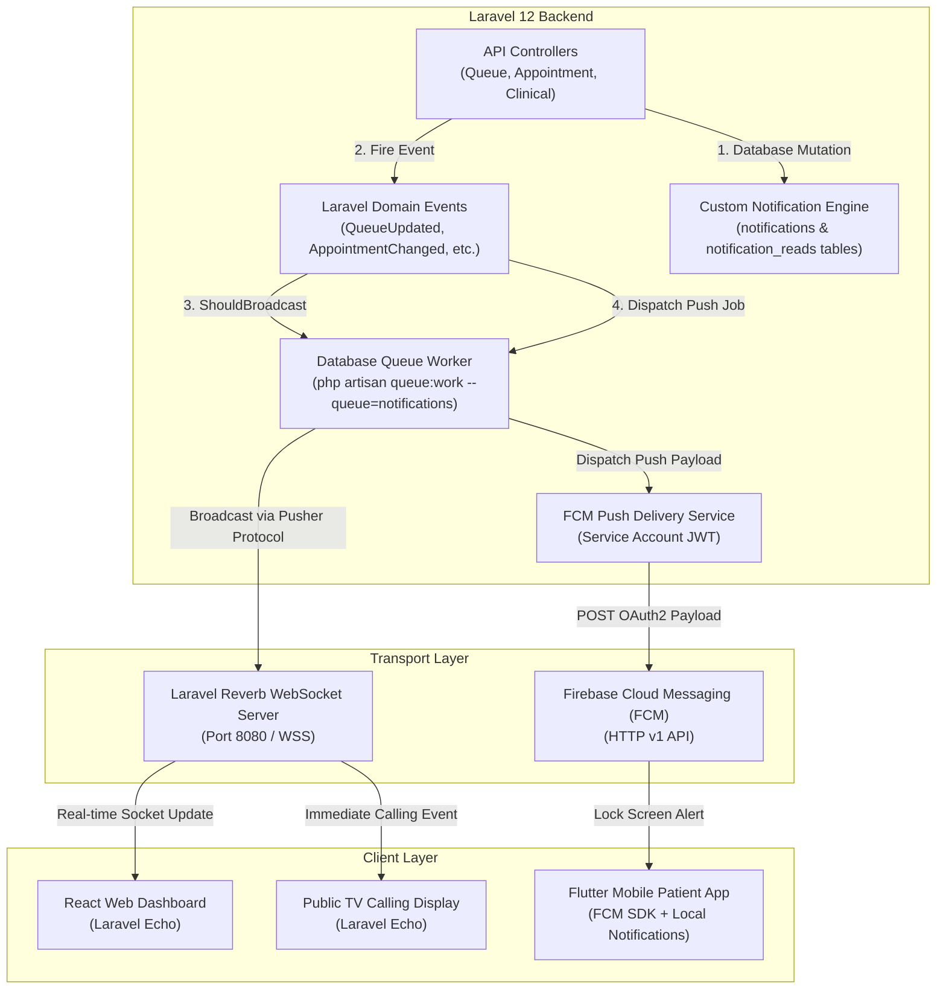
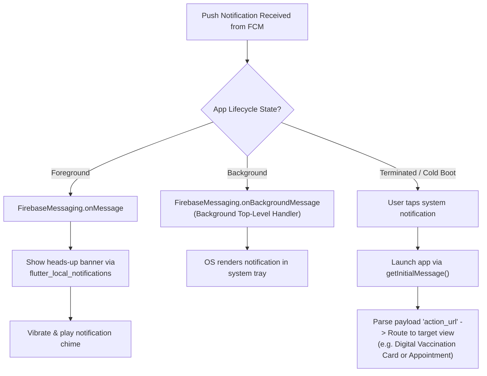
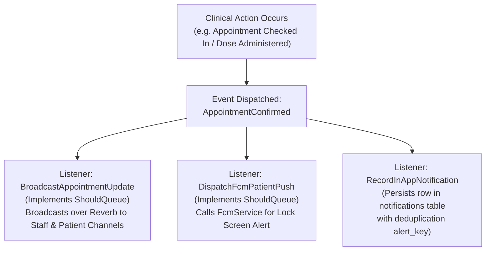

# Comprehensive System Audit and Implementation Plan: Real-Time Live Updates (Laravel Reverb & Echo) and Mobile Push Alerts (Firebase Cloud Messaging)

**Project:** Web and Mobile-Based Animal Bite Management and Monitoring System with Analytics  
**Version:** 1.0.0-PROPOSED  
**Audit Date:** November 16, 2026  
**Status:** AUDITED — READY FOR IMPLEMENTATION PLANNING  
**Target Delivery Document:** `docs/tasks/REALTIME_AND_FCM_IMPLEMENTATION_PLAN.md`  

---

## Executive Summary & System Compatibility Matrix

This document provides a comprehensive technical audit and architectural roadmap for upgrading the Animal Bite Treatment Center (ABTC) Management System. The upgrade will replace existing HTTP short-polling with event-driven WebSockets (**Laravel Reverb** and **Laravel Echo**) and introduce background lock-screen notifications for mobile patients via **Firebase Cloud Messaging (FCM)**.

### Architectural Compatibility Evaluation

| Layer | Current Architecture | Proposed Integration | Compatibility Verdict |
|---|---|---|:---:|
| **Backend Framework** | Laravel 12.0 (`laravel/framework: ^12.0`), PHP 8.2+ | **Laravel Reverb** (`laravel/reverb: ^1.4`) | **FULLY COMPATIBLE** (First-party Laravel 11/12 WebSocket engine) |
| **Authentication** | Laravel Sanctum 4.3 (`laravel/sanctum: ^4.3`) | Sanctum Bearer Token Auth for Private Channels | **FULLY COMPATIBLE** (Native channel guard) |
| **Queue Subsystem** | `database` driver (`jobs`, `failed_jobs`, `job_batches`) | Asynchronous Job Queue for Broadcasting & FCM | **FULLY COMPATIBLE** (Dedicated `notifications` queue exists) |
| **Web Frontend** | React 19.2 (`react: ^19.2.6`), Vite 8.0, Tailwind CSS 4 | **Laravel Echo** (`laravel-echo: ^1.16`) + `pusher-js: ^8.4` | **FULLY COMPATIBLE** (Standard client stack) |
| **Mobile App** | Flutter 3.x (Dart SDK `^3.12.1`), `http: ^1.6.0` | `firebase_core`, `firebase_messaging`, `flutter_local_notifications` | **FULLY COMPATIBLE** (Standard Flutter FCM integration) |
| **Data Separation** | Multi-tenant by `clinic_id`, RBAC roles (`admin`, `triage`, `treatment`, etc.) | Scoped Private Channels (`clinic.{id}.*`, `patient.{id}`) | **FULLY COMPATIBLE** (Isolates clinical and patient domains) |

---

# Phase 1 — System Audit and Architecture Assessment

## 1.1 Objective
Perform an exhaustive code-level audit of the entire repository across backend (Laravel), frontend (React), and mobile (Flutter) to inspect existing communication patterns, schemas, configurations, and dependencies. Establish a definitive baseline before making architectural modifications.

---

## 1.2 Existing Implementation Findings

### 1.2.1 Technology Stack & Core Architecture
* **Backend:** Laravel 12.0.1 on PHP 8.2+. Uses the minimal Laravel 11/12 application structure (`bootstrap/app.php`). No legacy `Kernel.php` or `BroadcastServiceProvider.php` exists.
* **Frontend:** React 19.2.6 SPA built with Vite 8.0.12, Material-UI 9.1.1, Tailwind CSS 4.3.3, and Axios 1.18.0. State management is organized around React Contexts (`AuthContext`, `NotificationContext`).
* **Mobile Application:** Flutter application targeting Android and iOS (Dart SDK `^3.12.1`). Uses `flutter_secure_storage` for token persistence and `http: ^1.6.0` for REST API consumption.
* **Database & Cache:** Default database driver is MySQL (`DB_CONNECTION=mysql`). Queue driver is database (`QUEUE_CONNECTION=database`). Cache store is database (`CACHE_STORE=database`).
* **Broadcasting Baseline:** `config/broadcasting.php` and `routes/channels.php` **do not exist**. `BROADCAST_CONNECTION=log` is defined in `.env.example`. No WebSocket daemon or broadcasting provider is currently registered.

---

### 1.2.2 Patient Queue Management Audit
* **Files Investigated:**
  * Backend Controller: `backend/app/Http/Controllers/Operations/QueueController.php`
  * Domain Service: `backend/app/Services/QueueService.php`
  * Eloquent Models: `Queue.php`, `QueueHistory.php`, `Station.php`
  * Policy: `backend/app/Policies/QueuePolicy.php`, `StationCapabilityPolicy.php`
  * Frontend Pages: `frontend/src/features/queue/pages/QueueDashboardPage.tsx`, `QueueDisplayPage.tsx`
  * Frontend Hooks & Services: `frontend/src/features/queue/hooks/useQueueData.ts`, `queueService.ts`
* **Current Operational Mechanism:**
  * Number Generation: Uses MySQL advisory locks (`SELECT GET_LOCK('queue_checkin_{clinicId}_{todayDate}', 5)`) for sequential, collision-free daily queue numbers (`1, 2, 3...`).
  * Status Flow: Transitions through 11 statuses (`waiting`, `called`, `serving`, `in_consultation`, `second_chance`, `final_recall`, `requires_checkin`, `completed`, `cancelled`, `absent`, `no_response`).
  * Doctor-to-Nurse Clinical Handoff: When a Triage Doctor completes Form 2 for a new bite incident, the ticket is not completed; the system updates `visit_type` to `'vaccination'`, resets status to `'waiting'`, and assigns it to `Station 1 - Intake`.
  * Public Screen (`QueueDisplayPage.tsx`): Full-screen dual-column display (Doctor Triage on the left, Station 1 & Station 2 Treatment Desks on the right). Uses HTML5 Web Audio API to synthesize a 4-tone chime (`523.25 Hz` to `1046.50 Hz`) when a patient is called.
* **Update & Polling Mechanism:**
  * Public TV Display: Short HTTP polling via `setInterval(loadQueue, 5000)` (**every 5 seconds**).
  * Staff Queue Dashboard: Short HTTP polling via `setInterval(() => loadData(true), 30000)` (**every 30 seconds**).
  * Server-side Cache: 30-second TTL cache (`Cache::remember("web:queue:clinic:{$clinicId}:date:{$date}", 30, ...)`) with immediate cache flush on mutations (`QueueService::flushCache()`).
* **Gaps & Missing Real-Time Features:**
  * Public display lags up to 5 seconds behind staff call actions.
  * Staff dashboard lags up to 30 seconds behind check-ins, transfers, and skips.
  * Generates excessive database query traffic across 5s polling intervals.

---

### 1.2.3 Patient Appointments Audit
* **Files Investigated:**
  * Backend: `backend/app/Http/Controllers/Operations/AppointmentController.php`, `MobileAppointmentController.php`, `AppointmentService.php`, `MobileAppointmentService.php`, `AppointmentReminderService.php`
  * Models: `Appointment.php`, `AppointmentReminder.php`
  * Migrations: `2026_08_03_224209_create_appointments_table.php` through `2026_09_13_220000_add_booster_to_appointment_and_queue_enums.php`
  * Mobile Views: `mobile/lib/views/appointments_view.dart`, `booking_view.dart`, `models/appointment_summary.dart`
  * Frontend: `frontend/src/features/appointments/pages/AppointmentManagementPage.tsx`, `AppointmentCalendarPage.tsx`
* **Current Operational Mechanism:**
  * Booking: Patients self-book Day 0 bite consultations or 2-dose boosters via mobile. Follow-up doses (Day 3, 7, 28) are automatically scheduled by `VaccinationRecordService` upon dose administration.
  * Operating Schedule Drift Engine: `ClinicScheduleService::resolveScheduleDate()` automatically shifts appointment dates forward to skip clinic weekend closures and holidays, logging `ideal_date`, `scheduled_date`, `schedule_drift_days`, and `schedule_adjustment_reason`.
  * Cancellation Restriction: Follow-up vaccination appointments (Day 3, 7, etc.) **cannot** be cancelled by patients on mobile to guarantee rabies immunization completion. Only Day 0 consultations can be cancelled.
  * Check-In: Atomic check-in transition from `scheduled` to `confirmed`, issuing a daily `queue_number` and queuing the ticket.
* **Update & Polling Mechanism:**
  * Web appointments list uses manual refetch on mount and filter changes.
  * Mobile app fetches appointments only on initial screen load (`initState()`) and user pull-to-refresh.
* **Gaps & Missing Real-Time Features:**
  * Web staff dashboard does not reflect newly submitted online bookings in real-time.
  * Patient mobile app does not update when clinic staff confirms, reschedules, or checks in an appointment without manual pull-to-refresh.

---

### 1.2.4 Notification System Audit
* **Files Investigated:**
  * Backend Models: `backend/app/Models/Notification.php`, `NotificationRead.php`
  * Backend Services: `backend/app/Services/NotificationService.php`, `MobileNotificationService.php`
  * Controllers: `backend/app/Http/Controllers/Settings/NotificationController.php`, `MobileNotificationController.php`
  * Frontend: `frontend/src/shared/contexts/NotificationContext.tsx`, `NotificationButton.tsx`, `NotificationToastContainer.tsx`, `notificationNavigation.ts`
  * Mobile: `mobile/lib/views/notifications_view.dart`, `models/app_notification.dart`
* **Current Operational Mechanism:**
  * Architecture: **Completely custom notification engine** using the `notifications` and `notification_reads` tables (Laravel's native `Illuminate\Notifications\Notification` system is **not used**; `app/Notifications` does not exist).
  * Dual Read Tracking:
    * Staff: Multi-user per-clinic broadcast with individual user read receipts tracked in `notification_reads` (`notification_id`, `user_id`, `read_at`).
    * Patients: Single-recipient status flags directly on `notifications` table (`status = 'read'`, `read_at = timestamp`).
  * Stateful Condition Alerts: `NotificationService::syncActiveAlerts()` detects low stock, batch expiry, overdue vaccination doses, and high-risk bite zones using deterministic keys (`alert_key`).
* **Update & Polling Mechanism:**
  * Web Staff: Short HTTP polling via `setInterval(fetchNotifications, 12000)` (**every 12 seconds**) in `NotificationContext.tsx`, plus instant poll on tab focus (`window.addEventListener('focus', ...)`).
  * Mobile: Manual pull-to-refresh on `NotificationsView`.
* **Gaps & Missing Real-Time Features:**
  * Web toasts and badges have up to 12 seconds latency.
  * Mobile patients receive **no notification** when the app is in the background or closed.

---

### 1.2.5 Vaccination Schedule and Vaccine Inventory Audit
* **Files Investigated:**
  * Backend Controllers: `VaccinationController.php`, `VaccinationRecordController.php`, `VaccineInventoryController.php`
  * Domain Services: `VaccinationScheduleService.php`, `VaccinationRecordService.php`, `VaccineInventoryService.php`, `VaccineInventoryUsageService.php`
  * Models: `VaccineInventory.php`, `InventoryTransaction.php`, `VaccinationSchedule.php` (proxy for `treatment_records`)
  * Frontend: `frontend/src/features/inventory/`, `frontend/src/features/vaccinations/`
* **Current Operational Mechanism:**
  * Multi-Dose Vial Sharing: `VaccineInventoryUsageService` implements automated FIFO stock allocation. The first intradermal patient opens a vial (`inventory_units_used = 1`, deducts 1 from `current_quantity`, sets `open_vial_discard_at` up to 8 hours). Subsequent patients sharing the vial deduct 0 stock (`inventory_units_used = 0`).
  * Overdue Sweep: `SendAutomatedAppointmentReminders` console command runs daily at 08:00 to detect defaulters and dispatch reminders.
* **Gaps & Missing Real-Time Features:**
  * When a nurse administers a dose and decrements stock, other nurse stations and the admin inventory dashboard do not update without a page refresh or re-navigation.
  * Patient mobile vaccination cards (`digital_card_updated`) require manual pull-to-refresh after nurse administration.

---

### 1.2.6 Mobile Push Notifications (FCM) Audit
* **Files Investigated:**
  * `mobile/pubspec.yaml`, `mobile/lib/main.dart`, `mobile/lib/app/app.dart`
  * Android Manifest: `mobile/android/app/src/main/AndroidManifest.xml`
  * Android Gradle: `mobile/android/app/build.gradle.kts`, `mobile/android/build.gradle.kts`
  * Docs: `docs/tasks/07-mobile-push-alerts-fcm/README.md`, `PLAN.md`, `FIREBASE_SETUP_GUIDE.md`
* **Current Operational Mechanism:**
  * Firebase SDK: **Not installed** in Flutter or Android native.
  * Credentials: `google-services.json` and `firebase-credentials.json` **do not exist**.
  * Permissions: `android.permission.POST_NOTIFICATIONS` is **missing** from `AndroidManifest.xml`.
  * Device Tokens: No device token management or storage exists on either frontend or backend.
  * Existing In-App UI: Comprehensive notification UI already exists in `mobile/lib/views/notifications_view.dart`, `widgets/notifications/notification_card.dart`, and `models/app_notification.dart`.

---

## 1.3 Identified Integration Requirements

1. **Zero-Breaking-Change Guarantee:** Existing REST APIs, polling fallbacks, and custom database notification structures must remain fully functional during and after WebSocket/FCM integration.
2. **Multi-Tenant Scoping:** All WebSocket channels must be scoped by `clinic_id` to prevent cross-facility data leakage.
3. **Role-Based Channel Authorization:** Only authenticated users with matching clinical roles may authorize on clinical broadcasting channels (e.g. `clinic.{id}.queue`, `clinic.{id}.inventory`).
4. **Privacy-Preserving Mobile Payloads:** Push notification payloads sent via FCM must not contain Protected Health Information (PHI) like rabies exposure category, bite anatomy, or full clinical diagnoses on lock screens.
5. **Decoupled Asynchronous Processing:** All WebSocket broadcasts and FCM dispatches must execute through Laravel Queues (`notifications` queue) to ensure zero overhead on synchronous clinical HTTP transactions.
6. **Graceful Offline Degradation:** If the WebSocket server is unreachable, clients must fall back silently to the existing HTTP polling mechanisms without disrupting clinical workflows.

---

## 1.4 Recommended Integration Architecture



---

## 1.5 Phase 1 Completion Checklist
- [x] Laravel version, service providers, and app bootstrap verified (`Laravel 12.0.1`, `PHP 8.2+`, minimal `bootstrap/app.php`).
- [x] Web frontend framework and dependencies verified (`React 19.2.6`, `Vite 8.0.12`).
- [x] Mobile application framework and dependencies verified (`Flutter 3.x`, `Dart 3.12.1`).
- [x] All 5 core functional modules audited (Queue, Appointments, Notifications, Vaccination, Inventory).
- [x] Broadcasting and Queue configurations inspected (`config/queue.php`, missing `config/broadcasting.php`).
- [x] Existing notification database tables and dual read receipt mechanisms analyzed.
- [x] Firebase and FCM presence in Flutter and Android configurations audited (Confirmed missing).
- [x] Comprehensive implementation roadmap formulated.

---

# Phase 2 — Real-Time Live Updates Implementation

## 2.1 Objective
Install, configure, and integrate **Laravel Reverb** on the backend and **Laravel Echo** on the React frontend. Implement authenticated private WebSocket channels for queue calling, appointment status changes, in-app staff notifications, and vaccine stock adjustments.

---

## 2.2 Required Dependencies

### Backend Dependencies
* `laravel/reverb: ^1.4` (First-party Laravel WebSocket server)
* `pusher/pusher-php-server: ^7.2` (Protocol driver used by Laravel to broadcast to Reverb)

### Frontend Dependencies
* `laravel-echo: ^1.16.1` (Client-side subscription manager)
* `pusher-js: ^8.4.0` (Underlying WebSocket connection driver)

---

## 2.3 Configuration Specifications

### 2.3.1 Backend Configuration
1. **Publish Broadcasting and Reverb Config:**
   * Run `php artisan install:broadcasting` to publish `config/broadcasting.php`, `config/reverb.php`, and create `routes/channels.php`.
2. **Environment Variables (`.env` and `.env.example`):**
   ```dotenv
   BROADCAST_CONNECTION=reverb

   REVERB_APP_ID=abtc-system-local
   REVERB_APP_KEY=abtc-reverb-key-2026
   REVERB_APP_SECRET=abtc-reverb-secret-2026
   REVERB_HOST="127.0.0.1"
   REVERB_PORT=8080
   REVERB_SCHEME=http

   VITE_REVERB_APP_KEY="${REVERB_APP_KEY}"
   VITE_REVERB_HOST="${REVERB_HOST}"
   VITE_REVERB_PORT="${REVERB_PORT}"
   VITE_REVERB_SCHEME="${REVERB_SCHEME}"
   ```
3. **Application Bootstrap (`backend/bootstrap/app.php`):**
   * Register broadcasting channel routes:
     ```php
     ->withRouting(
         web: __DIR__.'/../routes/web.php',
         api: __DIR__.'/../routes/api.php',
         commands: __DIR__.'/../routes/console.php',
         channels: __DIR__.'/../routes/channels.php',
         health: '/up',
     )
     ```

### 2.3.2 Frontend Configuration
Create singleton Echo client at `frontend/src/shared/services/echo.ts`:
```typescript
import Echo from 'laravel-echo';
import Pusher from 'pusher-js';

declare global {
  interface Window {
    Pusher: typeof Pusher;
    Echo: Echo;
  }
}

window.Pusher = Pusher;

export const createEchoClient = (token: string): Echo => {
  return new Echo({
    broadcaster: 'reverb',
    key: import.meta.env.VITE_REVERB_APP_KEY,
    wsHost: import.meta.env.VITE_REVERB_HOST,
    wsPort: import.meta.env.VITE_REVERB_PORT ?? 80,
    wssPort: import.meta.env.VITE_REVERB_PORT ?? 443,
    forceTLS: (import.meta.env.VITE_REVERB_SCHEME ?? 'https') === 'https',
    enabledTransports: ['ws', 'wss'],
    authEndpoint: `${import.meta.env.VITE_API_BASE_URL ?? ''}/api/broadcasting/auth`,
    auth: {
      headers: {
        Authorization: `Bearer ${token}`,
        Accept: 'application/json',
      },
    },
  });
};
```

---

## 2.4 Broadcasting Events and Channels

### Channel Authorization Definitions (`routes/channels.php`)
```php
use App\Models\User;
use App\Models\PatientAccount;
use Illuminate\Support\Facades\Broadcast;

// 1. Clinic Queue Channel (All staff & Public Display)
Broadcast::channel('clinic.{clinicId}.queue', function ($user, int $clinicId) {
    if ($user instanceof User) {
        return (int) $user->clinic_id === $clinicId;
    }
    return false;
});

// 2. Clinic Staff Notifications Channel
Broadcast::channel('clinic.{clinicId}.notifications', function ($user, int $clinicId) {
    return $user instanceof User && (int) $user->clinic_id === $clinicId;
});

// 3. Clinic Inventory Channel (Treatment & Admin roles)
Broadcast::channel('clinic.{clinicId}.inventory', function ($user, int $clinicId) {
    return $user instanceof User 
        && (int) $user->clinic_id === $clinicId 
        && in_array($user->role, ['admin', 'treatment', 'nurse', 'developer']);
});

// 4. Patient Private Channel
Broadcast::channel('patient.account.{accountId}', function ($user, int $accountId) {
    return $user instanceof PatientAccount && (int) $user->id === $accountId;
});
```

### Event Classes to Implement
1. **`App\Events\QueueTicketUpdated`**
   * Implements: `ShouldBroadcastNow` (instant broadcast to display/desks without queue lag)
   * Broadcast on: `new PrivateChannel("clinic.{$this->clinicId}.queue")`
   * Broadcast Name: `queue.updated`
   * Payload:
     ```json
     {
       "action": "called",
       "queue_id": 1024,
       "queue_number": 42,
       "patient_name": "J*** D**",
       "station_name": "Station 1 - Intake",
       "status": "called",
       "call_count": 1,
       "lane": "station1",
       "timestamp": "2026-11-16T15:30:00Z"
     }
     ```
2. **`App\Events\AppointmentStatusChanged`**
   * Implements: `ShouldBroadcast`
   * Broadcast on: `new PrivateChannel("clinic.{$this->clinicId}.queue")` and `new PrivateChannel("patient.account.{$this->patientAccountId}")`
   * Broadcast Name: `appointment.changed`
   * Payload: `appointment_id`, `patient_id`, `status` (`confirmed`, `rescheduled`, `cancelled`), `scheduled_date`, `queue_number`.
3. **`App\Events\StaffNotificationBroadcast`**
   * Implements: `ShouldBroadcast`
   * Broadcast on: `new PrivateChannel("clinic.{$this->clinicId}.notifications")`
   * Broadcast Name: `notification.created`
   * Payload: `notification_id`, `category`, `type`, `title`, `message`, `action_url`, `created_at`.
4. **`App\Events\VaccineStockUpdated`**
   * Implements: `ShouldBroadcast`
   * Broadcast on: `new PrivateChannel("clinic.{$this->clinicId}.inventory")`
   * Broadcast Name: `inventory.updated`
   * Payload: `inventory_id`, `batch_number`, `current_quantity`, `open_vial_status`, `open_vial_doses_used`, `open_vial_discard_at`.

---

## 2.5 Step-by-Step Implementation Tasks

* [ ] **Task 2.1:** Install Composer packages `laravel/reverb` and `pusher/pusher-php-server` in `backend/`.
* [ ] **Task 2.2:** Publish broadcasting configuration files and create `routes/channels.php`.
* [ ] **Task 2.3:** Add broadcasting route registration and Sanctum auth endpoint in `bootstrap/app.php`.
* [ ] **Task 2.4:** Define channel authorization callbacks in `routes/channels.php` with multi-tenant and role guards.
* [ ] **Task 2.5:** Create event classes: `QueueTicketUpdated`, `AppointmentStatusChanged`, `StaffNotificationBroadcast`, `VaccineStockUpdated`.
* [ ] **Task 2.6:** Wire event dispatches into `QueueService.php`, `AppointmentService.php`, `NotificationService.php`, and `VaccineInventoryUsageService.php`.
* [ ] **Task 2.7:** Install `laravel-echo` and `pusher-js` in `frontend/`.
* [ ] **Task 2.8:** Implement singleton Echo instance in `frontend/src/shared/services/echo.ts` bound to `AuthContext`.
* [ ] **Task 2.9:** Integrate Echo listeners in `QueueDisplayPage.tsx` and `useQueueData.ts` to trigger audio chimes and refresh active tickets on `queue.updated`.
* [ ] **Task 2.10:** Integrate Echo listener in `NotificationContext.tsx` to display real-time toasts on `notification.created` while retaining HTTP polling as a fallback.

---

## 2.6 Files Likely to Be Modified / Created
* `backend/composer.json` (Add packages)
* `backend/config/broadcasting.php` (New config)
* `backend/config/reverb.php` (New config)
* `backend/routes/channels.php` (New channel auth file)
* `backend/bootstrap/app.php` (Register channels route)
* `backend/app/Events/QueueTicketUpdated.php` (New event)
* `backend/app/Events/AppointmentStatusChanged.php` (New event)
* `backend/app/Events/StaffNotificationBroadcast.php` (New event)
* `backend/app/Events/VaccineStockUpdated.php` (New event)
* `backend/app/Services/QueueService.php` (Dispatch event)
* `backend/app/Services/AppointmentService.php` (Dispatch event)
* `backend/app/Services/NotificationService.php` (Dispatch event)
* `backend/app/Services/VaccineInventoryUsageService.php` (Dispatch event)
* `frontend/package.json` (Add dependencies)
* `frontend/src/shared/services/echo.ts` (New Echo service)
* `frontend/src/shared/contexts/NotificationContext.tsx` (Attach Echo listener)
* `frontend/src/features/queue/pages/QueueDisplayPage.tsx` (Attach Echo listener)
* `frontend/src/features/queue/hooks/useQueueData.ts` (Attach Echo listener)

---

## 2.7 Acceptance Criteria & Potential Risks
* **Acceptance Criteria:**
  * When a patient is marked `called` by a nurse or doctor, `QueueDisplayPage.tsx` triggers the audio chime and displays the ticket number in $< 300\text{ ms}$ without page refreshing.
  * When inventory stock is deducted, all active treatment nurse dashboards reflect updated quantities immediately.
  * If the Reverb daemon stops, all web interfaces fall back to existing HTTP polling intervals silently without throwing unhandled exceptions.
* **Potential Risks & Mitigations:**
  * *Risk:* Port 8080 blocked by firewalls in local deployment. *Mitigation:* Document reverse proxy configuration (Nginx / Caddy / Apache) to proxy WebSockets over standard 443 HTTPS.
  * *Risk:* Stale WebSocket connections during token refresh. *Mitigation:* Reconnect Echo with updated Sanctum bearer token in `AuthContext` on token renewal.

---

# Phase 3 — Firebase Cloud Messaging (FCM) Integration

## 3.1 Objective
Configure Firebase Cloud Messaging to deliver real-time and background lock-screen notifications to patients' mobile devices. Implement device registration token synchronization, backend FCM delivery services, and lifecycle handlers for foreground, background, and terminated application states.

---

## 3.2 Firebase Project Setup Requirements

1. **Firebase Console Project:**
   * Create project: `abtc-management-system`.
   * Add Android App: Package name `com.abtc.animal_bite_care` (matching `mobile/android/app/build.gradle.kts`).
   * Download configuration file: `google-services.json` and place in `mobile/android/app/`.
   * Add iOS App (Optional): Bundle ID `com.abtc.animalBiteCare`, download `GoogleService-Info.plist`.
2. **Service Account Credentials:**
   * Generate Private Key from Firebase Console -> Project Settings -> Service Accounts.
   * Save JSON credential securely in backend storage: `backend/storage/app/firebase-credentials.json` (ensure `.gitignore` excludes it).
   * Define environment variable: `FIREBASE_CREDENTIALS=storage/app/firebase-credentials.json`.

---

## 3.3 Mobile Application Configuration (Flutter)

### 3.3.1 Dependencies (`mobile/pubspec.yaml`)
```yaml
dependencies:
  firebase_core: ^3.12.1
  firebase_messaging: ^15.2.4
  flutter_local_notifications: ^18.0.1
```

### 3.3.2 Android Native Setup
1. **Root `mobile/android/build.gradle.kts`:**
   Add Google Services classpath:
   ```kotlin
   buildscript {
       dependencies {
           classpath("com.google.gms:google-services:4.4.2")
       }
   }
   ```
2. **App `mobile/android/app/build.gradle.kts`:**
   Apply Google Services plugin at the top:
   ```kotlin
   plugins {
       id("com.android.application")
       id("kotlin-android")
       id("dev.flutter.flutter-gradle-plugin")
       id("com.google.gms.google-services")
   }
   ```
3. **App Manifest `mobile/android/app/src/main/AndroidManifest.xml`:**
   Add permissions and notification channel metadata:
   ```xml
   <manifest xmlns:android="http://schemas.android.com/apk/res/android">
       <uses-permission android:name="android.permission.INTERNET"/>
       <uses-permission android:name="android.permission.POST_NOTIFICATIONS"/>
       <uses-permission android:name="android.permission.VIBRATE" />
       <uses-permission android:name="android.permission.RECEIVE_BOOT_COMPLETED"/>

       <application ...>
           <!-- Default notification channel for PEP reminders -->
           <meta-data
               android:name="com.google.firebase.messaging.default_notification_channel_id"
               android:value="abtcare_reminders" />
           <meta-data
               android:name="com.google.firebase.messaging.default_notification_icon"
               android:resource="@drawable/ic_notification" />
       </application>
   </manifest>
   ```

---

## 3.4 Device Token Management

### Database Schema Addition
Create migration `backend/database/migrations/2026_11_16_200000_create_patient_device_tokens_table.php`:
```php
Schema::create('patient_device_tokens', function (Blueprint $table) {
    $table->id();
    $table->foreignId('patient_account_id')->constrained('patient_accounts')->onDelete('cascade');
    $table->string('fcm_token', 500)->unique();
    $table->string('device_type', 50)->default('android'); // android, ios
    $table->string('device_name', 150)->nullable();
    $table->timestamp('last_used_at')->useCurrent();
    $table->timestamps();

    $table->index(['patient_account_id', 'device_type']);
});
```

### Backend API Endpoints (`routes/api.php`)
Under protected mobile group (`middleware(['auth:sanctum', 'patient.account'])`):
* `POST /api/mobile/device-token`: Register or refresh FCM device token.
* `DELETE /api/mobile/device-token`: Invalidate device token upon logout.

---

## 3.5 Laravel Backend FCM Delivery Engine

### Core Service: `App\Services\Messaging\FcmService.php`
Uses Google Auth library (`google/apiclient` or official OAuth2 token generator) to call the official **Firebase Cloud Messaging HTTP v1 API** (`https://fcm.googleapis.com/v1/projects/{project_id}/messages:send`):
```php
namespace App\Services\Messaging;

use App\Models\PatientAccount;
use Illuminate\Support\Facades\Http;
use Illuminate\Support\Facades\Log;

class FcmService
{
    public function sendToAccount(PatientAccount $account, string $title, string $body, array $data = []): bool
    {
        $tokens = $account->deviceTokens()->pluck('fcm_token')->toArray();
        if (empty($tokens)) {
            return false;
        }

        $accessToken = $this->getGoogleAccessToken();
        $projectId = config('services.firebase.project_id');

        foreach ($tokens as $token) {
            $payload = [
                'message' => [
                    'token' => $token,
                    'notification' => [
                        'title' => $title,
                        'body' => $body,
                    ],
                    'data' => array_map('strval', $data),
                    'android' => [
                        'priority' => 'HIGH',
                        'notification' => [
                            'channel_id' => 'abtcare_reminders',
                            'sound' => 'default',
                        ],
                    ],
                ],
            ];

            $response = Http::withToken($accessToken)
                ->post("https://fcm.googleapis.com/v1/projects/{$projectId}/messages:send", $payload);

            if ($response->failed()) {
                // If token is invalid or expired, delete from database
                if (str_contains($response->body(), 'UNREGISTERED') || $response->status() === 404) {
                    $account->deviceTokens()->where('fcm_token', $token)->delete();
                }
                Log::warning("FCM dispatch failure for account {$account->id}: " . $response->body());
            }
        }

        return true;
    }
}
```

---

## 3.6 Application State Notification Lifecycle (Flutter)



---

## 3.7 Step-by-Step Implementation Tasks

* [x] **Task 3.1:** Firebase Configuration & Mobile Gradle Integration (`google-services.json`, Gradle plugins, `firebase_core` & `firebase_messaging` dependencies, startup initialization).
* [x] **Task 3.2:** FCM Device Token Management and Patient Account Registration (`patient_device_tokens` migration, `PatientDeviceToken` model, `DeviceTokenService`, `PatientDeviceTokenController` with `POST /api/mobile/device-token` and `DELETE /api/mobile/device-token`, `FcmDeviceRegistrationService`, login/session restoration/logout token lifecycle synchronization).
* [x] **Task 3.3:** Mobile Push Notification Handling and Android Notification Channel Setup (Installed `flutter_local_notifications: ^18.0.1`, configured Android notification channel `abtcare_reminders` with High importance, sound, vibration, and `@drawable/ic_notification`; implemented `PushNotificationService` with foreground heads-up banners, `@pragma('vm:entry-point')` background handling, cold-boot `getInitialMessage()` tap routing with auth checks, deduplication set, and live in-app refresh; enabled Java 8+ core library desugaring in Gradle; aligned backend validation and DB token length constraint to 500 characters).
* [ ] **Task 3.4:** Implement `App\Services\Messaging\FcmService` using the FCM HTTP v1 API and Firebase service account credentials.
* [ ] **Task 3.5:** Implement background top-level message handler in `mobile/lib/main.dart` with `@pragma('vm:entry-point')`.
* [ ] **Task 3.6:** Connect `OutboundDelivery` and `AppointmentReminderService` to trigger `FcmService` for vaccination reminders, missed appointment recalls, and booking updates.
* [ ] **Task 3.7:** Wire deep-link routing on notification tap to open `AppRoutes.appointments` or `AppRoutes.digitalCard`.

---

# Phase 4 — Integration and Optimization

## 4.1 Objective
Unify Laravel Reverb broadcasting and FCM push delivery through a shared domain event pipeline. Guarantee that single business actions (e.g. appointment confirmation or dose administration) trigger both real-time UI updates and mobile lock-screen alerts without generating duplicate notification rows or redundant push dispatches.

---

## 4.2 Shared Event Architecture

To maintain strict separation of concerns, controllers will **not** invoke FCM or Reverb directly. Instead, controllers perform domain mutations and fire standard Laravel domain events. Specialized asynchronous listeners handle persistence, WebSocket broadcast, and FCM push:



---

## 4.3 Preventing Duplicate Notifications & Idempotency
1. **Deterministic Alert Keys:** Continue utilizing deterministic `alert_key` hashing for notifications (e.g. `overdue_dose:{patient_id}:{dose_number}:{date}`). If an active alert with this key exists, no duplicate database row or push alert is created.
2. **Token Invalidation on Logout:** When a patient logs out or changes password via mobile, `DELETE /api/mobile/device-token` deletes the FCM token, preventing notifications from arriving on devices no longer belonging to the patient.
3. **Queue Worker Rate Limiting:** All push jobs dispatch through the existing `notifications` queue managed by Laravel's database queue driver with rate limiting (30 requests/minute).

---

## 4.4 Error Handling and Reconnection
1. **Reverb Reconnection:** Laravel Echo includes automatic exponential backoff reconnection. If the WebSocket server restarts or the client experiences a brief network outage, Echo reconnects automatically and re-authenticates private channels.
2. **Silent Polling Fallback:** If Echo fails to establish a connection after 3 attempts, `NotificationContext` and `useQueueData` maintain existing HTTP polling loops (12s for notifications, 30s for queue, 5s for TV display).
3. **FCM Stale Token Cleanup:** When the FCM API returns HTTP 404 or `UNREGISTERED`, the backend immediately removes the dead token from `patient_device_tokens`.

---

# Phase 5 — Functional and Scenario-Based Testing

## 5.1 Objective
Execute a rigorous multi-scenario test suite across Web and Mobile to validate end-to-end real-time propagation, background push delivery, authorization isolation, and network resilience.

---

## 5.2 Test Scenarios and Acceptance Matrix

### Scenario 1: Real-Time Queue Advancing & Public TV Calling
* **Action:** Treatment Nurse calls ticket #14 for Station 1 from `/nurse/patients`.
* **Expected Result:**
  * Public display `/queue/display` triggers 4-tone synthesizer chime and updates "NOW SERVING" card to Ticket #14 in $< 300\text{ ms}$.
  * Other nurse dashboards update ticket status to `called` without manual page reload.
  * No duplicate chime triggers on subsequent status checks.

### Scenario 2: Online Mobile Appointment Booking
* **Action:** Patient submits Day 0 bite consultation appointment on Flutter mobile app.
* **Expected Result:**
  * Web staff appointment list and dashboard KPI counter increment immediately.
  * In-app toast appears for Registration Staff desk.
  * Patient mobile app displays booking confirmation card.

### Scenario 3: Mobile Push Delivery in Background State
* **Action:** Automated sweep runs `SendAutomatedAppointmentReminders`, identifying an upcoming Day 3 follow-up dose for tomorrow.
* **Expected Result:**
  * With the Flutter app minimized/in background, Android displays a system tray notification with title: *"Rabies Vaccination Reminder"* and body: *"You have a scheduled follow-up dose tomorrow. Please visit the clinic on time."*
  * Tapping the notification launches the app and navigates directly to `ScheduleCalendarView`.
  * No Protected Health Information (PHI) is exposed on the lock screen.

### Scenario 4: Cross-Clinic Channel Authorization Protection
* **Action:** A malicious actor attempts to connect to WebSocket channel `private-clinic.2.queue` using a Sanctum token issued for Clinic 1.
* **Expected Result:**
  * Reverb authentication endpoint `/api/broadcasting/auth` rejects the request with HTTP `403 Forbidden`.
  * No WebSocket frames or event data from Clinic 2 are transmitted.

### Scenario 5: Network Disconnection & Graceful Fallback
* **Action:** The internet connection drops on the Public Display TV or the Reverb daemon is stopped.
* **Expected Result:**
  * The application does not crash.
  * The client falls back silently to 5-second HTTP polling.
  * When connection restores, WebSocket resumes real-time push without duplicate event processing.

---

## 5.3 Phase 5 Completion Checklist
- [ ] Real-time queue calling verified on split-screen TV display with audio chime.
- [ ] Appointment status changes verified across web and mobile.
- [ ] In-app notification badge and toast verified across multiple clinical desks.
- [ ] FCM push notifications verified in foreground, background, and terminated states.
- [ ] Lock screen payloads verified free of sensitive medical diagnosis data.
- [ ] Reverb channel authorization rules verified against unauthorized token tampering.
- [ ] Automatic fallback to HTTP polling verified during simulated WebSocket failure.
- [ ] Zero duplicate notification rows verified in database.

---

# Implementation Plan Summary & Next Steps

### Implementation Priorities
1. **Priority 1 (Foundation):** Install `laravel/reverb`, publish configuration, and create `routes/channels.php`.
2. **Priority 2 (WebSockets Client):** Install `laravel-echo` and `pusher-js` in React frontend and connect to `NotificationContext` and `QueueDisplayPage`.
3. **Priority 3 (Broadcasting Events):** Implement `QueueTicketUpdated` and `StaffNotificationBroadcast` events and wire into services.
4. **Priority 4 (FCM Project & Token Schema):** Create `patient_device_tokens` table, establish Firebase console project, and place `google-services.json` in Android project.
5. **Priority 5 (FCM Backend & Mobile Handler):** Implement `FcmService.php`, background Flutter handler, and test lock-screen alerts.

### Recommended Immediate First Task
Proceed with **Task 2.1**: Installing `laravel/reverb` and configuring broadcasting channels on the Laravel backend.
