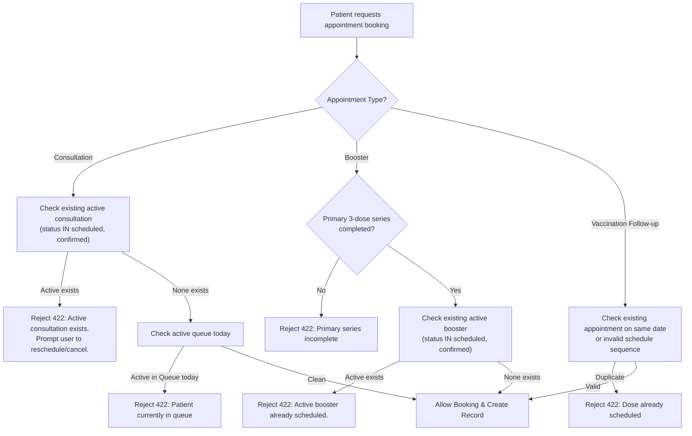

# Implementation Plan: Appointment Booking Validation & Patient Profile Linking Strategy

## 1. Executive Summary & Problem Overview

In the **Tagoloan Animal Bite Treatment Center (RHU)** system, two core operational challenges have been identified regarding online appointments and patient profiles:

1. **Multiple / Duplicate Bookings for the Same Profile:**
   - Currently, `MobileAppointmentService::bookAppointment` does not check if a patient profile (`patient_id`) already has an active, pending, or upcoming appointment.
   - Users can create multiple bookings across dates, causing slot hoarding, no-shows, and conflicting bite intake records.
2. **Medical Record Fragmentation (Walk-In vs. Mobile Sign-Up):**
   - Patients who first visit as walk-ins have complete clinic charts (vaccination dates, bite severity, rabies series doses Day 0/3/7).
   - When the same patient later registers independently on the mobile app, `MobilePatientProfileService::createPatient` creates a detached second patient record (`registration_source = 'mobile'`).
   - If they book online, their appointment attaches to this new detached chart, leaving the doctor and nurse blind to their prior walk-in vaccination history.

This plan details the implementation of **Option A Booking Validation** and the **3-Layer Patient Linking Strategy** to address both issues cohesively.

---

## 2. Part 1: Option A — Active Appointment Booking Validation

### 2.1 Medical & Operational Rationale
Under Option A, an appointment booking is rejected if the profile already has an active upcoming appointment of that care type. Unlike "same-date-only" blocking (which permits slot hoarding on multiple different days), Option A guarantees:
- One active bite consultation ticket per patient at any given time.
- Prevention of duplicate bite intakes for the same incident.
- Clean patient queue management with mandatory reschedule or cancel workflows.

### 2.2 Validation Rules Specification
In `MobileAppointmentService::bookAppointment` and `StoreMobileAppointmentRequest`:



#### Detailed Rule Set:
1. **Bite Consultation (`consultation`):**
   - Query: `Appointment::where('patient_id', $patientId)->whereIn('status', ['scheduled', 'confirmed'])->where('appointment_type', 'consultation')->whereDate('scheduled_date', '>=', Carbon::today())->first()`
   - Response on violation:
     ```json
     {
       "message": "This patient profile already has an upcoming bite consultation scheduled for [Date] ([Time Slot]). Please reschedule or cancel the existing appointment if you need a different date.",
       "existing_appointment": {
         "appointment_id": 123,
         "scheduled_date": "2026-11-20",
         "time_slot": "morning"
       }
     }
     ```
2. **Booster Consultation (`booster`):**
   - Check 1: Primary series completion (`$patient->has_completed_primary`).
   - Check 2: No active booster already in progress (`status IN ['scheduled', 'confirmed']` and `dose_number IN [90, 365]`).
3. **Queue Lock Guard:**
   - If the patient is already active in today's clinic queue (`waiting`, `called`, `serving`, `in_consultation`), online booking for today is blocked with instructions to proceed directly to the triage desk.

---

## 3. Part 2: The 3-Layer Walk-In vs. Online Account Linking Strategy

To ensure zero duplicate patient charts and seamless medical record continuity, three complementary layers will be deployed:

```
┌─────────────────────────────────────────────────────────────────────────────┐
│ LAYER 1: MOBILE SIGN-UP MATCHING (Self-Service Proactive)                   │
│ Patient registers on mobile ➔ Optional "Have you visited before?" lookup    │
│ Checks Name + DOB + Phone or Patient Number ➔ Links to existing chart       │
└──────────────────────────────────────┬──────────────────────────────────────┘
                                       │ (If missed by patient)
                                       ▼
┌─────────────────────────────────────────────────────────────────────────────┐
│ LAYER 2: CLINIC CHECK-IN MERGE & LINK (Fail-Safe at Reception Desk)         │
│ Online booked patient arrives ➔ Staff clicks Check-In                       │
│ Duplicate detection flags walk-in match ➔ 1-Click "Link & Merge Chart"      │
└──────────────────────────────────────▲──────────────────────────────────────┘
                                       │ (Alternative proactive pathway)
┌──────────────────────────────────────┴──────────────────────────────────────┐
│ LAYER 3: PREVENTATIVE WALK-IN PORTAL INVITATION (Clinic to Mobile)          │
│ Walk-in completes Day 0 ➔ Staff triggers SMS/Email invitation link          │
│ Account creation automatically inherits verified clinic patient ID          │
└─────────────────────────────────────────────────────────────────────────────┘
```

---

### 3.1 Layer 1: Mobile App Matching during Profile Creation (Proactive)
When a mobile user creates a patient profile under their account (`MobilePatientProfileService::createPatient`):
1. **Search for Existing Chart:**
   - Query existing clinic records with matching:
     - Exact `last_name` + `first_name` + `date_of_birth` (high confidence)
     - OR explicit `patient_number` (e.g. `TAG-2026-0042`) provided by the patient.
2. **Action if Match Found:**
   - If the patient record has no existing verified mobile account:
     - Attach the mobile account to the existing `patient_id` in `patient_account_patient` with `status: 'pending'` (or send a 6-digit SMS verification code to the contact number on file for instant verification).
     - **Prevent creating a duplicate patient row** in the database.
   - If the patient record already has an account:
     - Inform the user that an account already exists for this medical chart and offer account recovery.

---

### 3.2 Layer 2: Staff Check-In "Link & Merge" (Fail-Safe at Clinic Desk)
When a patient signs up without linking and books an appointment online, they arrive at the clinic:
1. **Detection:**
   - When Registration staff searches or clicks **"Check-In"** for an online-booked patient, `PatientService::checkDuplicatePatients` runs in the background.
2. **Staff Alert Dialog:**
   - If an existing walk-in record with matching demographic data is detected, display a clear reconciliation modal:
     > **Potential Existing Record Detected:**
     > **Online Booking:** Hazel Ann Nandong (Mobile pre-reg, No past doses)
     > **Existing Clinic Chart:** Hazel Ann Nandong (#TAG-2026-0012, 2 doses completed on Oct 2026)
     > *Options:* `[Link to Existing Chart & Check In]` | `[Keep as Separate Patient]`
3. **Link & Merge Execution (`/api/patients/link-and-merge`):**
   - Reassigns the online `Appointment` and `BiteIncidentIntake` to the existing walk-in `patient_id`.
   - Links the `PatientAccount` to the existing walk-in `patient_id`.
   - Safely removes or archives the unverified duplicate mobile `patients` placeholder.
   - Checks the patient into Station 1 (Doctor) queue using their original medical record.

---

### 3.3 Layer 3: Preventative Walk-In Portal Invitation (Clinic to Mobile)
1. **Workflow:**
   - After a walk-in patient completes their Day 0 registration, the Registration/Triage screen provides a prominent button: **"📱 Send Mobile Portal Invite"**.
   - Leverages the existing `PatientInvitationService::send` via SMS or Email.
2. **Seamless Onboarding:**
   - The patient receives an SMS/Email with an activation token.
   - Opening the link prompts password creation and automatically attaches their mobile account to their verified clinic patient chart without manual profile data entry.

---

## 4. Database & Endpoint Specifications

### 4.1 Backend Endpoints to Create / Update

| Endpoint | Method | Role | Description |
| :--- | :--- | :--- | :--- |
| `/api/mobile/appointments` | `POST` | Patient | Enforce Option A validation (block multiple active bookings). |
| `/api/mobile/patients/find-existing` | `POST` | Patient | Look up existing clinic chart by Patient No. or Name + DOB before creating a new profile. |
| `/api/mobile/patients` | `POST` | Patient | Update `createPatient` to link to existing chart if verified match found. |
| `/api/patients/{id}/merge-online-booking` | `POST` | Registration / Staff | Reassign appointment & intake from mobile placeholder to canonical walk-in record. |
| `/api/patient-invitations` | `POST` | Staff | Existing invitation trigger for walk-in patients (to be made prominent in Form 1). |

---

## 5. Implementation Roadmap

### Phase 1: Option A Mobile Booking Validation (Immediate Priority)
- [ ] Add check in `MobileAppointmentService::bookAppointment` for existing `scheduled` or `confirmed` appointments.
- [ ] Return structured 422 payload including existing appointment details.
- [ ] Add unit and feature tests in `MobileAppointmentCharacterizationTest.php`.

### Phase 2: Staff Check-In Match & Link Capability (Layer 2 Fail-Safe)
- [ ] Build backend service method `PatientService::mergeMobileBookingIntoExistingChart`.
- [ ] Add UI confirmation dialog in `PatientListPage.tsx` when checking in an online booking that matches an existing walk-in record.

### Phase 3: Mobile Self-Service Chart Match (Layer 1 Proactive)
- [ ] Add lookup helper in `MobilePatientProfileService` to query existing clinic charts on profile creation.
- [ ] Connect existing account linking pivot table (`patient_account_patient`).

### Phase 4: Walk-in Portal Invite UX Polish (Layer 3 Preventative)
- [ ] Expose "Send Mobile Portal Invite" button directly on patient registration completion banner.

---

## 6. Verification & Testing Strategy
1. **Automated Backend Tests:**
   - Test: Booking a second consultation while one is scheduled fails with 422.
   - Test: Booking after cancelling or completing a prior appointment succeeds.
   - Test: Linking an online booking reassigns intake and appointment to canonical walk-in record.
2. **Manual Regression & UI Verification:**
   - Verify error messages on mobile screens are friendly, indicating the existing appointment date and giving clear reschedule/cancel buttons.
   - Verify staff check-in modal prevents duplicate queue numbers and preserves all past doses on Tagoloan Treatment Card.
