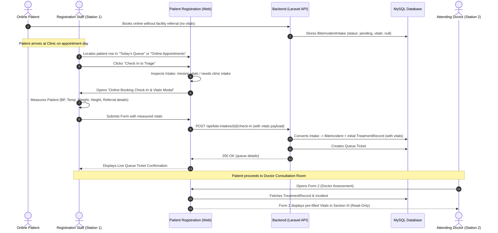
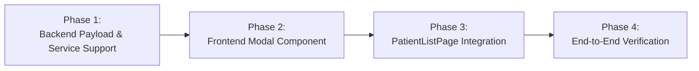

# Implementation Plan: Online Booking Check-In Vitals & Referral Modal Restoration

## 1. Executive Summary & Problem Analysis

### 1.1 The Issue
In the **Tagoloan Animal Bite Treatment Center (RHU)** system, patients who book an online initial consultation via the mobile app without an external health facility referral (`isReferred = false`) submit their booking without pre-arrival vitals (Blood Pressure, Temperature, Weight, Height) or referral provider details.

When this patient physically arrives at the clinic:
1. Registration staff opens the **Patient Registration** page (`/patients` — `PatientListPage.tsx`).
2. The patient row displays the action button: **`[ Check In to Triage ]`**.
3. Clicking this button triggers `handleMobileIntakeCheckIn()`, which **immediately fires a direct POST request** (`POST /api/bite-intakes/{id}/check-in`) without presenting any modal dialog.
4. The patient is placed directly into the active triage queue (`visit_type = 'new_case'`, `status = 'waiting'`).
5. When the attending Doctor opens Form 2 (**Doctor Consultation & Risk Assessment** — `GeneralTreatmentForm.tsx` / `VitalsConsultationSection.tsx`), Section III (**Consultation Details & Vitals**) is strictly **read-only** for physicians and displays the banner:
   > *"Entered by Registration Staff during patient registration. These values are read-only. Only Registration Staff can update them through Patient Registration."*
6. Consequently, the patient reaches the consultation desk with **completely blank vital signs and referral metadata**, with no sanctioned mechanism for the doctor to enter registration vitals.

---

### 1.2 Comparison with Other Registration Check-In Workflows

| Registration Workflow | Entry Point / Component | Vitals & Referral Capture Mechanism | Status |
|---|---|---|---|
| **New Walk-In Patient** | `AddPatientModal.tsx` | Fills **Section III: Consultation Details & Vitals** (`RegistrationVitalsSection.tsx`) | Working |
| **Returning Patient (Reassessment)** | `ReturningPatientCheckInModal.tsx` | Intercepted on check-in: requires updated BP, Temp, Weight, Height | Working |
| **Re-Exposure Registration** | `PatientDetailsModal.tsx` (`newExposureOpen`) | Dialog prompts for re-bite date + `RegistrationVitalsSection` | Working |
| **Online Mobile Booking (With Referral)** | `BiteIncidentIntake` | Patient attached photo & reported pre-arrival vitals from BHS | Present but unverified by clinic |
| **Online Mobile Booking (Without Referral)** | `PatientListPage.tsx` -> `handleMobileIntakeCheckIn` | **Bypassed completely (direct 1-click API call without modal)** | **BUG: Missing Modal** |

---

## 2. Clinical Workflow & Architecture

### 2.1 Station Responsibility Architecture

Under DOH NRPCP and RHU operational guidelines:
* **Station 1 (Registration Desk)** owns patient identification, demographic verification, triage ticketing, initial vital signs triage (Blood Pressure, Temperature, Weight, Height), and referral intake slip inspection.
* **Station 2 (Doctor Triage & Assessment)** owns exposure grading (Category I/II/III), wound examination, prescription of PEP / anti-tetanus / RIG regimens, and medical decisions. Vitals from Station 1 are reviewed as baseline.
* **Station 3 (Treatment / Nurse Room)** owns biological administration (Form 3) and batch tracking.



---

## 3. Detailed Technical Specifications

### 3.1 Frontend Architecture

#### A. New Modal Component: `OnlineIntakeCheckInModal.tsx`
* **Location:** `frontend/src/features/patients/components/OnlineIntakeCheckInModal.tsx`
* **Purpose:** Collects clinic-measured vitals, consultation date/time, and referral confirmation when checking in an online-booked patient.
* **Key Fields & Controls:**
  1. **Patient & Appointment Header:**
     - Displays patient name, patient number, appointment date, and reported exposure details (animal species, bite date).
  2. **Online Referral Attachment Preview (if attached):**
     - Integrates `<OnlineReferralPhoto patient={patient} />` so registration staff can cross-reference physical or uploaded referral slips.
     - If patient reported pre-arrival vitals in the mobile app, pre-fill those fields as default values for staff verification.
  3. **Clinic Vitals Collection (Section III format):**
     - `consultation_date`: Date input (defaults to today's date in `Asia/Manila` timezone).
     - `consultation_time`: Time input (defaults to current time in `Asia/Manila` timezone).
     - `blood_pressure`: Text input formatted `systolic/diastolic` mmHg with validation (e.g. `120/80`).
     - `temperature`: Numeric input (°C, e.g. `36.5`).
     - `weight`: Numeric input (kg, e.g. `65`).
     - `height`: Numeric input (cm, e.g. `170`).
     - `attending_provider`: Text input (defaults to logged-in Registration staff name or clinic default).
     - `referred_by`: Text input for referring health facility (optional/conditional if walk-in or BHS referred).
  4. **Validation Rules:**
     - Blood Pressure, Temperature, Weight, and Height are validated before submission.
     - Clean inline error feedback following `FormModal` standards.

#### B. Updates to `PatientListPage.tsx`
* **Location:** `frontend/src/features/patients/pages/PatientListPage.tsx`
* **State Management:**
  ```tsx
  const [onlineCheckInTarget, setOnlineCheckInTarget] = useState<{
    patient: Patient;
    intake: any;
  } | null>(null);
  ```
* **Check-In Handler Interception:**
  Modify `handleMobileIntakeCheckIn`:
  ```tsx
  const handleOpenMobileIntakeCheckIn = (patient: Patient, intake: any) => {
    // Intercept check-in to show the vitals modal
    setOnlineCheckInTarget({ patient, intake });
  };
  ```
* **Table Action Button:**
  Update the button `onClick`:
  ```tsx
  onClick={(event) => {
    (event.currentTarget as HTMLElement).blur();
    handleOpenMobileIntakeCheckIn(p, mobileIntakeForCheckIn);
  }}
  ```
* **Modal Integration in JSX:**
  ```tsx
  {onlineCheckInTarget && (
    <OnlineIntakeCheckInModal
      open={Boolean(onlineCheckInTarget)}
      patient={onlineCheckInTarget.patient}
      intake={onlineCheckInTarget.intake}
      onClose={() => setOnlineCheckInTarget(null)}
      onSuccess={(modalData) => {
        setOnlineCheckInTarget(null);
        setCheckInModalData(modalData);
        fetchPatients();
      }}
    />
  )}
  ```

---

### 3.2 Backend Architecture

#### A. Request Validation: `CheckInBiteIntakeRequest.php`
* **Location:** `backend/app/Http/Requests/Clinical/CheckInBiteIntakeRequest.php`
* **Validation Rules:**
  ```php
  return [
      'consultation_date'   => ['nullable', 'date'],
      'consultation_time'   => ['nullable', 'string', 'max:20'],
      'blood_pressure'      => ['nullable', 'string', 'regex:/^\d{2,3}\/\d{2,3}$/'],
      'temperature'         => ['nullable', 'numeric', 'between:30,45'],
      'weight'              => ['nullable', 'numeric', 'between:0.5,300'],
      'height'              => ['nullable', 'numeric', 'between:20,250'],
      'attending_provider'  => ['nullable', 'string', 'max:255'],
      'referred_by'         => ['nullable', 'string', 'max:255'],
      'mode_of_transaction' => ['nullable', 'string', 'in:walk-in,online,referral'],
  ];
  ```

#### B. Controller Update: `BiteIncidentIntakeController@checkIn`
* **Location:** `backend/app/Http/Controllers/Clinical/BiteIncidentIntakeController.php`
* **Implementation:**
  Pass validated payload from `$request->all()` into `BiteIncidentIntakeService::checkIn($intake, $request->user(), $request->all())`.

#### C. Service Update: `BiteIncidentIntakeService.php`
* **Location:** `backend/app/Services/Clinical/BiteIncidentIntakeService.php`
* **Implementation Details:**
  1. In `checkIn(BiteIncidentIntake $intake, User $user, array $payload = [])`:
  2. After creating the `BiteIncident`, create or sync the initial baseline `TreatmentRecord` (consultation card, `dose_number = null`):
     ```php
     $consultationRecord = TreatmentRecord::create([
         'clinic_id'               => $clinicId,
         'patient_id'              => $lockedIntake->patient_id,
         'bite_id'                 => $incident->bite_id,
         'dose_number'             => null,
         'status'                  => 'scheduled',
         'consultation_date'       => $payload['consultation_date'] ?? now()->toDateString(),
         'consultation_time'       => $payload['consultation_time'] ?? now()->format('H:i'),
         'blood_pressure'          => $payload['blood_pressure'] ?? $lockedIntake->referral_blood_pressure,
         'temperature'             => $payload['temperature'] ?? $lockedIntake->referral_temperature,
         'height'                  => $payload['height'] ?? $lockedIntake->referral_height,
         'weight'                  => $payload['weight'] ?? $lockedIntake->referral_weight,
         'attending_provider'      => $payload['attending_provider'] ?? $lockedIntake->referral_provider_name ?? $user->name,
         'referred_by'             => $payload['referred_by'] ?? $lockedIntake->referral_facility,
         'mode_of_transaction'     => $payload['mode_of_transaction'] ?? 'online',
         'reg_date_of_consultation'=> $payload['consultation_date'] ?? now()->toDateString(),
         'reg_consultation_time'   => $payload['consultation_time'] ?? now()->format('H:i'),
         'reg_blood_pressure'      => $payload['blood_pressure'] ?? $lockedIntake->referral_blood_pressure,
         'reg_temperature'         => $payload['temperature'] ?? $lockedIntake->referral_temperature,
         'reg_height'              => $payload['height'] ?? $lockedIntake->referral_height,
         'reg_weight'              => $payload['weight'] ?? $lockedIntake->referral_weight,
         'reg_attending_provider'  => $payload['attending_provider'] ?? $lockedIntake->referral_provider_name ?? $user->name,
         'reg_referred_by'         => $payload['referred_by'] ?? $lockedIntake->referral_facility,
         'created_by'              => $user->id,
     ]);
     ```
  3. Associate `$consultationRecord->record_id` with the queue ticket or incident context so Doctor Form 2 loads it automatically.

---

## 4. Step-by-Step Implementation Roadmap



### Phase 1: Backend Support for Intake Check-In Vitals
1. Create `CheckInBiteIntakeRequest.php` with validation rules for vital signs and consultation metadata.
2. Update `BiteIncidentIntakeController::checkIn` method signature to use `CheckInBiteIntakeRequest`.
3. Update `BiteIncidentIntakeService::checkIn` to accept `$payload` and persist vital signs into the newly created initial consultation `TreatmentRecord`.
4. Ensure `BiteIncidentIntakeCheckInTest.php` covers:
   - Check-in with full vitals payload.
   - Check-in with pre-existing mobile referral vitals.
   - Backward-compatibility check-in without payload (empty payload defaults gracefully).

### Phase 2: Create `OnlineIntakeCheckInModal.tsx`
1. Build `OnlineIntakeCheckInModal.tsx` with:
   - Header displaying Patient identification and bite incident summary.
   - Referral photo preview accordion (`OnlineReferralPhoto`).
   - Vital signs form inputs (BP, Temp, Height, Weight, Provider, Facility).
   - Auto-population from `intake.referral_*` if the patient reported them on mobile.
   - Cancel and "Check In to Doctor Triage" buttons.

### Phase 3: Wire into `PatientListPage.tsx`
1. Import `OnlineIntakeCheckInModal` in `PatientListPage.tsx`.
2. Add modal target state `onlineCheckInTarget`.
3. Connect the "Check In to Triage" button for online intake rows to open `OnlineIntakeCheckInModal`.
4. Handle success callback: trigger `checkInModalData` confirmation and refresh `fetchPatients()`.

### Phase 4: Verification & Testing
1. **Scenario 1 (Online booking WITHOUT referral):**
   - Book online in mobile/seeder with no referral.
   - Verify Registration shows "Check In to Triage".
   - Click button: confirm `OnlineIntakeCheckInModal` appears.
   - Enter BP `120/80`, Temp `36.6`, Weight `60`, Height `165`.
   - Submit check-in: confirm queue ticket is assigned.
   - Log in as Doctor: open Form 2 for this patient.
   - Verify Section III displays the entered vitals in read-only format.
2. **Scenario 2 (Online booking WITH referral & photo):**
   - Book online with referral photo and pre-arrival vitals.
   - Click "Check In to Triage": verify modal opens with pre-filled vitals and viewable photo.
   - Confirm and check in: verify Form 2 receives all verified vitals.

---

## 5. Risk Assessment & Mitigations

| Risk | Impact | Mitigation |
|---|---|---|
| **Stale or Slow Network on Check-In** | Double submission creates duplicate queues | Use debounce / `submitting` button disable state, and database transaction lock (`GET_LOCK` / `lockForUpdate`). |
| **Invalid BP formatting (e.g. letters)** | Backend validation error or corrupted clinical records | Mask input on frontend with systolic/diastolic slash format and backend regex validation (`^\d{2,3}\/\d{2,3}$`). |
| **Backward Compatibility with Mobile Intakes** | Older mobile client intakes lack referral fields | All vitals fields in check-in request accept nulls and default cleanly to Manila timestamp and logged-in user. |
| **Module Configuration Disabled** | Clinic has disabled Triage Station | Reuse existing `guardStations` policy; button is already conditionally hidden when Triage is off. |

---

## 6. Document Metadata & Approval
* **Created:** November 13, 2026
* **Target Directory:** `docs/tasks/online_booking_checkin_vitals_modal_plan.md`
* **Related Specifications:**
  - `docs/tasks/booking_validation_and_patient_linking_plan.md`
  - `workflow/abtc_patient_lifecycle_and_station_routing_workflow.md`
  - `docs/task_nov102016/person_4_workflow_and_verification.md`
