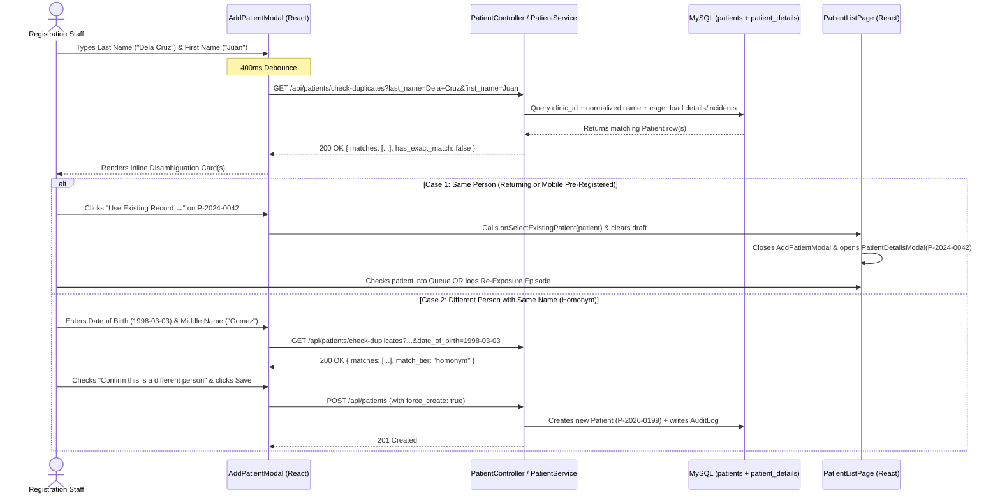

# 📋 Implementation Plan: Patient Record Redundancy Prevention & Homonym (Same-Name) Resolution

This document outlines the clinical architecture, multi-factor matching rules, UI wireframes, API contracts, and step-by-step implementation roadmap for preventing duplicate patient records at the **Tagoloan Animal Bite Treatment Center (ABTC)** while safely handling patients who share the same first and last name (homonyms).

---

## 🧭 1. Executive Summary & Clinical Problem Statement

### Why Duplicate Records Happen at the Registration Desk
In day-to-day clinic operations, registration staff frequently click **`+ Register Patient`** (`AddPatientModal`) as soon as a walk-in patient arrives at the window, without searching the Patient Registry first. Duplicate records arise in three common situations:
1. **Returning PEP Patient (Months or Years Later):** The patient had a previous bite episode at Tagoloan ABTC (e.g., in 2024 or early 2026) and returns for a new animal bite exposure.
2. **Mobile Pre-Registered Patient Arriving as Walk-In:** The patient created a profile in the ABTC Mobile App (`registration_source = 'mobile'`), then walks into the clinic and gives their name at the registration window without mentioning they used the app.
3. **Same-Day Double Entry:** Two registration clerks or a page refresh causes the same walk-in patient to be entered twice.

### Clinical Danger of Duplicate Records (DOH AO 2018-0013)
* **Hidden PEP Immunization History:** A patient's completed primary anti-rabies series (`Day 0, Day 3, Day 7` -> `has_completed_primary = true`) is attached to their original `patient_id`. If a duplicate `patient_id` is created, the Triage Doctor and Treatment Nurse will see the patient as **naive (unvaccinated)** and may prescribe a full 4-dose PEP regimen + costly Equine/Human Rabies Immunoglobulin (RIG) instead of a **2-dose Booster regimen (Day 0 & Day 3 without RIG)**.
* **Fragmented Active Episodes:** Ongoing vaccination schedules (`Day 3, Day 7, Day 28`) and mobile app notifications remain tied to the old record, causing missed-dose false alarms in clinic surveillance reports.

### The "Same Name" (Homonym) Challenge
In a municipal clinic serving thousands of residents, **two genuinely different people frequently share the same First Name and Last Name** (e.g., two different individuals named *"Juan Dela Cruz"* or *"Maria Santos"*, or relatives such as *"Juan Dela Cruz Sr."* and *"Juan Dela Cruz Jr."*).
* **Why a hard `UNIQUE(first_name, last_name)` constraint fails:** Blocking registration by name alone would prevent legitimate patients who happen to share a name with an existing patient from being registered.
* **The Solution:** A **Proactive Disambiguation & 3-Tier Confidence System** directly inside `AddPatientModal` paired with a **Backend `409 Conflict` Safety Guard** with explicit staff override (`force_create`).

---

## 🧠 2. Multi-Factor Matching & 3-Tier Confidence Classification

When registration staff types a patient's name (and optional Date of Birth / Middle Name / Suffix) inside `AddPatientModal`, the system normalizes the input (trimming whitespace, collapsing multiple spaces, stripping trailing periods on suffixes like `Jr.` → `jr`, case-insensitive comparison) and classifies any existing clinic records into **three confidence tiers**:

| Tier | Match Classification | Matching Criteria | Clinical Meaning | System Behavior |
| :--- | :--- | :--- | :--- | :--- |
| **🔴 Tier 1** | **`exact` (Exact Identity Match)** | Same `last_name` + `first_name` **AND** same `date_of_birth` (or same `philhealth_no`) | **99% Likely the Same Person** returning to the clinic or pre-registered via mobile. | Displays **Red/Amber High-Alert Card**. Blocks "Save" unless staff clicks **`Use Existing Record`** OR explicitly checks the override box (*"Confirm different person"*). Backend enforces `409 Conflict` if `force_create != true`. |
| **🟠 Tier 2** | **`high` (Name Match — DOB Pending)** | Same `last_name` + `first_name` (+ matching or empty `middle_name`), while `date_of_birth` has **not yet been typed** in the form | **Possible Returning Patient** — triggered immediately after typing First & Last Name so staff doesn't waste time filling the rest of the form. | Displays **Amber Warning Card** right below the Name fields showing the existing patient's Birthdate, Age, Barangay, and Mother's Maiden Name so staff can ask the patient immediately. |
| **🟡 Tier 3** | **`homonym` (Same Name, Different DOB)** | Same `last_name` + `first_name`, **BUT** the entered `date_of_birth` is **different** from the existing record's `date_of_birth` | **Likely a Homonym (Different Person with Same Name)** — OR a typo in the Birthdate just entered by staff. | Displays **Informational Homonym Card** comparing the existing patient's DOB/Barangay/Middle Name against the new entry. Staff checks `[x] Verified different person / birthdate` and proceeds normally. |

### Secondary Disambiguation Identifiers Displayed on Every Match Card
To allow registration staff to tell two same-name people apart in **under 5 seconds**, every match card displays:
1. **Full Structured Name:** `First Name` + **`Middle Name`** + `Last Name` + **`Suffix`** (e.g., *Juan **Santos** Dela Cruz **Jr.***)
2. **Patient Number & Source Badge:** `P-2026-0042` • `[📱 Mobile Account]` or `[🏥 Walk-In Record]`
3. **Date of Birth, Age & Sex:** `Born: May 15, 1990 (36 yrs old) • Male`
4. **Barangay & Municipality:** `Brgy. Poblacion, Tagoloan` (from `patient_details`)
5. **Mother's Maiden Name:** `Mother: Maria Santos` (from `patient_details`, if recorded)
6. **Clinical & PEP Status Badge:**
   * `🛡️ PEP Completed (Booster Eligible)` — if `has_completed_primary === true`
   * `💉 Active PEP Case (Episode #1)` — if an active/ongoing episode exists
   * `📋 Pre-Registered (No Visit Yet)` — if created via mobile app with no clinic visit yet

---

## 🖥️ 3. UI Wireframes (Inside `AddPatientModal`)

### Scenario A: Staff Types Surname & First Name (Immediate Live Check Before DOB is Typed)
As soon as staff finishes typing `Last Name` (*Dela Cruz*) and `First Name` (*Juan*), after a 400ms debounce, the inline banner slides open directly below the Name/DOB fields inside **Section I. Patient Information**:

```text
┌────────────────────────────────────────────────────────────────────────────────────────┐
│ I. PATIENT INFORMATION                                                                 │
├────────────────────┬────────────────────┬────────────────────┬─────────────────────────┤
│ Last Name *        │ First Name *       │ Middle Name        │ Suffix                  │
│ [ Dela Cruz      ] │ [ Juan           ] │ [                ] │ [                     ] │
├────────────────────┴────────────────────┼────────────────────┼─────────────────────────┤
│ Sex (Kasarian) *                        │ Date of Birth *    │ Blood Type              │
│ ( ) Female   (•) Male                   │ [ mm/dd/yyyy     ] │ [ — Select —        ▼ ] │
├─────────────────────────────────────────┴────────────────────┴─────────────────────────┤
│ ⚠️ EXISTING PATIENT(S) WITH THIS NAME FOUND IN CLINIC REGISTRY (2 matches)             │
│ Please verify with the patient before filling out the rest of this form:               │
│                                                                                        │
│ ┌────────────────────────────────────────────────────────────────────────────────────┐ │
│ │ 1. Juan Santos Dela Cruz   [P-2024-0042]  [🏥 Walk-In]  [🛡️ PEP Completed]         │ │
│ │    🎂 DOB: May 15, 1990 (36 yrs) • Male • 📍 Brgy. Poblacion, Tagoloan             │ │
│ │    👩 Mother's Maiden Name: Maria Santos • Last Visit: Aug 15, 2024                │ │
│ │                                                    [ ⚡ Use Existing Record → ]     │ │
│ ├────────────────────────────────────────────────────────────────────────────────────┤ │
│ │ 2. Juan Reyes Dela Cruz Jr. [P-2026-0118] [📱 Mobile Pre-Registered]               │ │
│ │    🎂 DOB: Oct 12, 2004 (21 yrs) • Male • 📍 Brgy. Baluarte, Tagoloan              │ │
│ │    👩 Mother's Maiden Name: Elena Reyes  • No clinic visits yet                    │ │
│ │                                                    [ ⚡ Use Existing Record → ]     │ │
│ └────────────────────────────────────────────────────────────────────────────────────┘ │
└────────────────────────────────────────────────────────────────────────────────────────┘
```

---

### Scenario B: Exact Match Detected (Same Name + Same Date of Birth)
If the staff enters `Date of Birth: 05/15/1990`, matching `Juan Santos Dela Cruz (P-2024-0042)` exactly:

```text
┌────────────────────────────────────────────────────────────────────────────────────────┐
│ 🔴 POSSIBLE DUPLICATE RECORD — EXACT NAME & BIRTHDATE MATCH                            │
│ "Juan Dela Cruz" born May 15, 1990 is already registered in this clinic.               │
│ Creating a duplicate record will hide their previous PEP vaccination history!          │
│                                                                                        │
│ ┌────────────────────────────────────────────────────────────────────────────────────┐ │
│ │ Juan Santos Dela Cruz   [P-2024-0042]  [🛡️ PEP Completed — Booster Eligible]       │ │
│ │ 🎂 DOB: May 15, 1990 (36 yrs) • Male • 📍 Brgy. Poblacion, Tagoloan                │ │
│ │ 👩 Mother's Maiden Name: Maria Santos                                              │ │
│ │                                        [ ⚡ Open Existing Patient Record → ]        │ │
│ └────────────────────────────────────────────────────────────────────────────────────┘ │
│                                                                                        │
│ [ ] I have verified their Middle Name, Barangay, and Mother's Maiden Name and          │
│     confirm this is a DIFFERENT person who shares the same name and birthdate.         │
└────────────────────────────────────────────────────────────────────────────────────────┘
```
* **While unchecked:** The modal's **Save / Register Patient** button is disabled (or highlights this confirmation box if clicked).
* **If staff clicks `[ ⚡ Open Existing Patient Record → ]`:**
  * `AddPatientModal` discards the draft and closes.
  * `PatientListPage` immediately opens `PatientDetailsModal` for `P-2024-0042` so the clerk can click **Check In to Queue** or **Register Re-Exposure / New Bite Episode**.

---

### Scenario C: Homonym Detected (Same First + Last Name, Different Date of Birth)
If the patient at the window says *"My birthday is March 3, 1998"* (which does not match May 15, 1990 or Oct 12, 2004):

```text
┌────────────────────────────────────────────────────────────────────────────────────────┐
│ ℹ️ SAME-NAME RECORD EXISTS WITH A DIFFERENT BIRTHDATE (Homonym Check)                  │
│ Another "Juan Dela Cruz" exists (Born May 15, 1990 • Brgy. Poblacion).                 │
│                                                                                        │
│ [x] I verified the patient's birthdate (Mar 3, 1998) is correct and this is a          │
│     new, different patient (not P-2024-0042).                                          │
└────────────────────────────────────────────────────────────────────────────────────────┘
```
* Staff checks the box (or leaves it checked once confirmed) and completes the registration normally.

---

## 🔄 4. End-to-End Workflow Architecture



---

## 🔌 5. Technical Specifications (Backend & Database)

### 5.1 Database Migration (Fast Composite Index)
**File:** `backend/database/migrations/2026_10_26_000001_add_duplicate_lookup_index_to_patients_table.php`
* Adds a composite index on `patients (clinic_id, last_name, first_name, date_of_birth)` so live duplicate queries execute via index range scan in `< 5ms`.

### 5.2 Duplicate Check Endpoint (`GET /api/patients/check-duplicates`)
* **Route:** `GET /api/patients/check-duplicates` (Protected by `auth:sanctum`, `active.user`, `role:admin,registration,developer,triage,treatment`)
* **FormRequest:** `backend/app/Http/Requests/Clinical/CheckDuplicatePatientRequest.php`
  ```php
  public function rules(): array
  {
      return [
          'first_name'         => ['required', 'string', 'min:2', 'max:255'],
          'last_name'          => ['required', 'string', 'min:2', 'max:255'],
          'middle_name'        => ['nullable', 'string', 'max:255'],
          'suffix'             => ['nullable', 'string', 'max:50'],
          'date_of_birth'      => ['nullable', 'date'],
          'gender'             => ['nullable', 'in:male,female'],
          'exclude_patient_id' => ['nullable', 'integer'],
      ];
  }
  ```
* **Matching Logic in `PatientService::checkDuplicatePatients(int $clinicId, array $input)`:**
  1. Normalize `first_name`, `last_name`, `middle_name`, `suffix` (lowercase, trimmed, collapsed spaces).
  2. Query `Patient::where('clinic_id', $clinicId)`:
     * Where `LOWER(TRIM(last_name))` matches normalized `last_name`
     * AND (`LOWER(TRIM(first_name))` matches normalized `first_name` OR starts with / contains normalized `first_name` for compound names like *"Mary Jane"* vs *"Mary"*).
     * Exclude `exclude_patient_id` if provided (used when editing an existing patient).
  3. Eager-load `details`, `biteIncidents` (latest), and `accounts` (to detect mobile linkage).
  4. Classify each candidate into `match_tier`:
     * `'exact'`: First & Last name match AND `date_of_birth` matches input `date_of_birth`.
     * `'high'`: First & Last name match AND `date_of_birth` was not provided in input yet (or middle name also matches).
     * `'homonym'`: First & Last name match, `date_of_birth` WAS provided in input, and `candidate.date_of_birth !== input.date_of_birth` (or suffixes explicitly differ, e.g., `Sr.` vs `Jr.`).
  5. Sort candidates with `'exact'` first, then `'high'`, then `'homonym'`, limited to 5 results.

* **Response Payload Contract:**
  ```json
  {
    "has_exact_match": true,
    "has_matches": true,
    "matches": [
      {
        "patient_id": 42,
        "patient_number": "P-2024-0042",
        "first_name": "Juan",
        "middle_name": "Santos",
        "last_name": "Dela Cruz",
        "suffix": null,
        "full_name": "Juan Santos Dela Cruz",
        "gender": "male",
        "date_of_birth": "1990-05-15",
        "age": 36,
        "registration_source": "staff",
        "has_mobile_account": false,
        "address_barangay": "Poblacion",
        "address_municipality": "Tagoloan",
        "mother_maiden_name": "Maria Santos",
        "has_completed_primary": true,
        "active_episodes_count": 0,
        "last_visit_date": "2024-08-15",
        "match_tier": "exact"
      }
    ]
  }
  ```

### 5.3 Backend Safety Guard in `POST /api/patients` (`PatientService::storePatient`)
Even if a clerk types very fast and clicks Save before the 400ms frontend debounce finishes:
1. Inside `PatientService::storePatient()`, before creating the `Patient` record, check if an **`exact` match** (`clinic_id` + normalized `first_name` + normalized `last_name` + `date_of_birth`) exists.
2. If an exact match exists and `empty($rawInput['force_create'])`:
   * Throw / return **HTTP `409 Conflict`**:
     ```json
     {
       "message": "A patient with the exact same name and birth date already exists (P-2024-0042). Please use the existing record or confirm that this is a different person.",
       "code": "duplicate_patient_detected",
       "duplicates": [ ... ]
     }
     ```
3. If `force_create === true`:
   * Proceed with creating the new `Patient` record.
   * Record an explicit audit trail entry in `AuditLog`:
     * `action`: `'create_homonym_override'`
     * `description`: `"Staff {$user->name} confirmed new patient {$patient->name} ({$patient->patient_number}) is distinct from existing same-name record(s): P-2024-0042"`

---

## 🛡️ 5.5 Main-Flow Safety Precautions & Zero-Regression Guarantees

To guarantee that the primary patient registration, auto-queueing, vitals consultation creation, and PEP workflows are **never disrupted**, the implementation enforces the following 7 strict precautions:

1. **Fail-Open Live Duplicate Check (Network & Server Resilience):**
   * The live check (`GET /api/patients/check-duplicates`) in `AddPatientModal` uses an `AbortController` and a `try / catch` block that **fails silently** if the network drops, times out, or is aborted during rapid typing.
   * A failed or slow background check **never** disables inputs, clears form state, or blocks the staff from filling out and submitting the registration form.
2. **100% Preserved `POST /api/patients` Success Contract:**
   * When creating a patient, `POST /api/patients` returns the **exact same `201 Created` JSON structure** (`{ message: 'Patient registered successfully', patient: ... }`) with `registeredBy`, `details`, and `memberships` loaded.
   * Existing downstream actions in `createPatientRecord()` — specifically automatic `/api/queue` check-in when `autoQueue: true`, initial `BiteIncident` (`pending_assessment`), and initial `TreatmentRecord` creation when vitals are provided — remain completely untouched.
3. **Narrow, Non-Disruptive `409 Conflict` Backend Guard:**
   * The backend `409 Conflict` guard in `PatientService::storePatient()` triggers **only** when:
     1. Both `first_name` and `last_name` match (case-insensitive, trimmed) within the same `clinic_id`, **AND**
     2. `date_of_birth` is non-null on both the incoming request and the existing record and matches on the exact calendar date (`Y-m-d`), **AND**
     3. Suffixes do not conflict (e.g., `Juan Dela Cruz Sr.` vs `Juan Dela Cruz Jr.` are recognized as distinct people and are **not** blocked even if a birthdate is shared or omitted), **AND**
     4. `force_create` is not `true`.
   * Any patient with a unique name, a different `date_of_birth` (homonym), or a different suffix passes through `POST /api/patients` on the first click with **zero friction**.
4. **Laravel Route Precedence Protection (`routes/api.php`):**
   * `Route::get('/patients/check-duplicates', [PatientController::class, 'checkDuplicates'])` is registered **above** `Route::get('/patients/{id}', [PatientController::class, 'show'])` so Laravel's router never mistakes `'check-duplicates'` for a `{id}` parameter.
5. **Draft Persistence (`useFormDraft`) Integrity:**
   * Typing in `AddPatientModal` continues saving drafts normally via `useFormDraft('add-patient')`.
   * The draft is only cleared when:
     * The new patient is successfully saved (`onSuccess()`),
     * The clerk explicitly clicks **"Discard draft"**, or
     * The clerk explicitly clicks **"Use Existing Record →"** to switch to an existing patient's profile.
6. **Optional Prop Backward Compatibility (`AddPatientModalProps`):**
   * `onSelectExistingPatient?: (patientId: number) => void` is strictly optional in `AddPatientModalProps`, ensuring any existing or future parent component rendering `<AddPatientModal />` compiles and functions without modification.
7. **Clinic Isolation & Soft-Delete Respect:**
   * Duplicate lookups strictly scope to `$request->user()->clinic_id` and automatically exclude soft-deleted patients (`deleted_at IS NULL`), preventing ghost conflicts from deleted test records.

---

## 🛠️ 6. Step-by-Step Implementation Roadmap

### Phase 1: Database Index & Backend Duplicate Service
- [x] **Step 1.1:** Create migration `2026_10_26_000001_add_duplicate_lookup_index_to_patients_table.php` adding composite index on `(clinic_id, last_name, first_name, date_of_birth)`.
- [x] **Step 1.2:** Create `backend/app/Http/Requests/Clinical/CheckDuplicatePatientRequest.php`.
- [x] **Step 1.3:** Update `backend/app/Http/Requests/Clinical/StorePatientRequest.php` to allow optional `'force_create' => 'nullable|boolean'`.
- [x] **Step 1.4:** Implement `checkDuplicatePatients()` and the pre-save `409 Conflict` guard + `AuditLog` override logging in `backend/app/Services/Clinical/PatientService.php`.
- [x] **Step 1.5:** Add `checkDuplicates()` action to `backend/app/Http/Controllers/PatientController.php` and register `GET /api/patients/check-duplicates` in `backend/routes/api.php`.

### Phase 2: Frontend Duplicate Banner & Modal Integration
- [x] **Step 2.1:** Add `checkDuplicatePatients()` API helper and `DuplicatePatientMatch` TypeScript interfaces in `frontend/src/features/patients/types/patient.types.ts` and `frontend/src/features/patients/services/patientService.ts`.
- [x] **Step 2.2:** Create `frontend/src/features/patients/components/AddPatientModal/sections/DuplicatePatientBanner.tsx` to render the color-coded match cards, disambiguation details (DOB, Barangay, Mother's Maiden Name, PEP badge), **`Use Existing Record →`** action button, and override confirmation checkbox.
- [x] **Step 2.3:** Integrate 400ms debounced duplicate checking into `AddPatientModal.tsx` when `last_name`, `first_name`, `middle_name`, `suffix`, or `date_of_birth` change, plus handling for `409 Conflict` responses on submit.
- [x] **Step 2.4:** Wire `onSelectExistingPatient` in `AddPatientModalProps` and `PatientListPage.tsx` so clicking **`Use Existing Record →`** closes `AddPatientModal` and opens `PatientDetailsModal` for that existing patient.

### Phase 3: Automated Testing & Verification
- [x] **Step 3.1:** Write backend feature test suite `backend/tests/Feature/Clinical/PatientDuplicatePreventionTest.php` testing:
  1. `GET /api/patients/check-duplicates` returns `exact`, `high`, and `homonym` tiers accurately.
  2. Compound first names and case/whitespace variations are matched properly.
  3. `POST /api/patients` blocks unconfirmed exact duplicates with `409 Conflict` and returns the duplicate summary.
  4. `POST /api/patients` with `force_create: true` succeeds for verified same-name homonyms and writes an `AuditLog` entry.
  5. Same-name patients with different `date_of_birth` values can be registered cleanly.
- [x] **Step 3.2:** Run `npm run build` (`tsc -b && vite build`) and full PHPUnit suite to verify 0 regressions.
