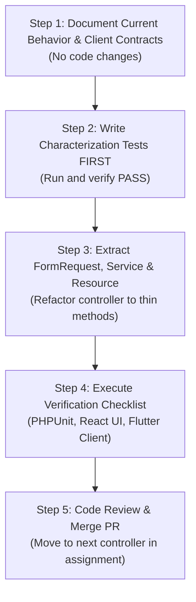

# Comprehensive 4-Person Controller Refactor Plan
**Project:** Animal Bite Management System (ABMS)  
**Backend:** Laravel 12 API  
**Clients:** React + TypeScript Web App & Flutter Mobile App  
**Target Directory:** `backend/app/Http/Controllers/` (38 Controllers, ~9,228 LOC)

---

## 1. Executive Summary & Architectural Goals

The goal of this refactoring initiative is to make backend controllers **thin, readable, and significantly easier to debug**, without modifying business logic, altering API contracts, or breaking existing React web and Flutter mobile client integrations.

### Core Objectives
1. **Thin Controllers:** Controllers only receive HTTP requests, delegate execution to dedicated FormRequests and Services/Actions, and return standardized API responses.
2. **FormRequest Validation:** Move all inline `$request->validate([...])` into dedicated `FormRequest` classes.
3. **Encapsulated Business Logic:** Move database queries, mutations, external API calls, and business rules into domain `Service` or `Action` classes.
4. **Standard API Resources:** Format response shapes consistently using Laravel API Resources while strictly maintaining backward-compatible JSON keys, types, and nullability.
5. **Visible Side Effects & Transaction Integrity:** Explicitly expose and preserve DB transactions (`DB::transaction`), queued jobs, audit logs, notifications, and event dispatches in their exact current execution order.
6. **Structured Context Logging:** Attach a unique `request_id` via `Log::withContext(['request_id' => ...])` across all log entries for end-to-end request traceability.
7. **Strict Non-Swallowing Exception Handling:** Eliminate silent `try/catch` blocks that suppress errors or obscure diagnostic stack traces.

---

## 2. Complete Inventory of All 38 Backend Controllers

The backend contains 38 controller files distributed across root, subdirectories, and domain namespaces:

| # | Controller Path | Lines | Primary Responsibility |
| :---: | :--- | :---: | :--- |
| 1 | `backend/app/Http/Controllers/VaccinationRecordController.php` | 1,215 | Dose administration, vial tracking, batch deduction, voiding |
| 2 | `backend/app/Http/Controllers/QueueController.php` | 1,131 | Clinic queue management, calling, ticket routing, second-chance |
| 3 | `backend/app/Http/Controllers/AppointmentController.php` | 1,131 | Follow-up scheduling, check-ins, upcoming/overdue lists |
| 4 | `backend/app/Http/Controllers/BiteCaseController.php` | 1,108 | Exposure cases, risk classification, geographic map data, puroks |
| 5 | `backend/app/Http/Controllers/VaccineInventoryController.php` | 977 | Stock cards, FIFO batches, vial opening, inventory adjustments |
| 6 | `backend/app/Http/Controllers/PatientController.php` | 810 | Patient master registry, demographics, triage search |
| 7 | `backend/app/Http/Controllers/TreatmentRecordController.php` | 674 | Clinical treatment sheets, doctor addendums, clinical summaries |
| 8 | `backend/app/Http/Controllers/VaccinationJourneyController.php` | 405 | PEP journey tracking matrix, automated sweep recalls, SMS |
| 9 | `backend/app/Http/Controllers/UserController.php` | 331 | Admin user management, CRUD, assigned module, role toggling |
| 10 | `backend/app/Http/Controllers/ClinicSetupController.php` | 316 | First-time clinic setup, onboarding wizard, branding |
| 11 | `backend/app/Http/Controllers/AuthController.php` | 310 | Web/staff authentication, session tokens, Google SSO, profile |
| 12 | `backend/app/Http/Controllers/PatientInvitationController.php` | 304 | Patient portal invites, invitation email tokens, activation |
| 13 | `backend/app/Http/Controllers/TagoloanTreatmentCardController.php` | 296 | Official municipal bite treatment card data & cards |
| 14 | `backend/app/Http/Controllers/Mobile/MobileHistoryController.php` | 295 | Patient aggregated medical and appointment history |
| 15 | `backend/app/Http/Controllers/VaccinationController.php` | 285 | Dose administration scheduling, reschedule, mark missed |
| 16 | `backend/app/Http/Controllers/Mobile/PatientAccountAuthController.php` | 256 | Mobile Flutter registration, verification, mobile login |
| 17 | `backend/app/Http/Controllers/ClinicScheduleController.php` | 236 | Operating hours, holidays, booking slot exceptions |
| 18 | `backend/app/Http/Controllers/Mobile/MobileAppointmentController.php` | 236 | Patient mobile appointment browsing and self check-in |
| 19 | `backend/app/Http/Controllers/Mobile/MobileVaccinationCardController.php` | 235 | Digital vaccination card & verification QR |
| 20 | `backend/app/Http/Controllers/StaffInvitationController.php` | 214 | Staff onboarding invites, token validation, acceptance |
| 21 | `backend/app/Http/Controllers/BiteIncidentIntakeController.php` | 194 | Triage/desk intake check-in, nurse incident review |
| 22 | `backend/app/Http/Controllers/Mobile/PatientProfileController.php` | 166 | Mobile patient profile details, phone/password update |
| 23 | `backend/app/Http/Controllers/ClinicModuleConfigController.php` | 140 | Station-specific feature flags and module routing |
| 24 | `backend/app/Http/Controllers/PrintController.php` | 109 | Printable treatment records, consent forms, cards |
| 25 | `backend/app/Http/Controllers/AuditLogController.php` | 97 | Audit trail indexing, user activity logs |
| 26 | `backend/app/Http/Controllers/Mobile/MobileLocationController.php` | 92 | Clinic GPS coordinates and purok reference data |
| 27 | `backend/app/Http/Controllers/DeveloperDatabaseExplorerController.php` | 91 | Dev-only database schema inspection |
| 28 | `backend/app/Http/Controllers/RegistrationReportController.php` | 90 | Patient registration and intake throughput reports |
| 29 | `backend/app/Http/Controllers/LandingPageSettingsController.php` | 80 | Public portal landing page CMS and announcements |
| 30 | `backend/app/Http/Controllers/NotificationController.php` | 78 | Web app header notification bell and read receipts |
| 31 | `backend/app/Http/Controllers/ReportController.php` | 67 | DOH bite epidemiological and monthly reports |
| 32 | `backend/app/Http/Controllers/Mobile/MobileNotificationController.php` | 65 | Mobile Flutter in-app notification center |
| 33 | `backend/app/Http/Controllers/Developer/AppointmentDiagnosticController.php` | 61 | Dev diagnostic endpoints for appointment slots |
| 34 | `backend/app/Http/Controllers/StaffSignatureController.php` | 30 | Staff digital signature profile binding |
| 35 | `backend/app/Http/Controllers/PatientAccessController.php` | 30 | Access gate verification for patient portal |
| 36 | `backend/app/Http/Controllers/PublicStorageController.php` | 28 | Secure serving of public uploads / assets |
| 37 | `backend/app/Http/Controllers/BiteIntakeSchemaController.php` | 10 | Dynamic intake form schema definition |
| 38 | `backend/app/Http/Controllers/Controller.php` | 6 | Base Controller |

---

## 3. The 4-Person Domain Breakdown

The 38 controllers are partitioned into four distinct, non-overlapping domains to prevent git merge conflicts and ensure balanced responsibility.

```
┌─────────────────────────────────────────────────────────────────────────────┐
│                    PERSON 4: Shared Infrastructure & Architecture           │
│           (Base Controller, Request ID, Global Exception Handler,           │
│                 Standardized API Response Helper, Pilot Reports)            │
└──────────────┬──────────────────────────────┬───────────────────────────────┘
               │                              │
               ▼                              ▼
┌──────────────────────────────┐┌──────────────────────────────┐┌──────────────────────────────┐
│           PERSON 1           ││           PERSON 2           ││           PERSON 3           │
│   Auth, Users & Identity     ││   Clinical Care & Cases      ││ Operations & Medical Logistics│
│  8 Controllers (~1,641 lines)││  6 Controllers (~3,092 lines)││ 7 Controllers (~5,378 lines) │
└──────────────────────────────┘└──────────────────────────────┘└──────────────────────────────┘
```

---

### PERSON 1: Auth, Users, Security & Identity
- **Scope:** Web and mobile user authentication, credentials, password policies, invitation tokens, and user profiles.
- **Total Workload:** 8 Controllers, ~1,641 lines of code.
- **Risk Profile:** **Highest Security Risk**. Breaking changes to tokens, password hashing, or Sanctum cookies/headers will immediately lock staff or mobile patients out of the application.
- **Assigned Controllers:**
  1. `backend/app/Http/Controllers/AuthController.php` (310 lines)
  2. `backend/app/Http/Controllers/UserController.php` (331 lines)
  3. `backend/app/Http/Controllers/StaffInvitationController.php` (214 lines)
  4. `backend/app/Http/Controllers/StaffSignatureController.php` (30 lines)
  5. `backend/app/Http/Controllers/PatientInvitationController.php` (304 lines)
  6. `backend/app/Http/Controllers/PatientAccessController.php` (30 lines)
  7. `backend/app/Http/Controllers/Mobile/PatientAccountAuthController.php` (256 lines)
  8. `backend/app/Http/Controllers/Mobile/PatientProfileController.php` (166 lines)
- **Primary Client Dependencies:**
  - React: `frontend/src/shared/services/auth.service.ts`, `frontend/src/contexts/AuthContext.tsx`, `frontend/src/services/staffApi.ts`.
  - Flutter: `mobile/lib/services/mobile_api.dart` (`login`, `register`, `googleLogin`, `account`, `updateAccount`), `mobile/lib/models/patient_account_profile.dart`.

---

### PERSON 2: Clinical Care, Bite Cases & Treatment Records (COMPLETED)
- **Status:** **COMPLETED** (Refactored into Thin Controllers + FormRequests & Services, 61 Feature Tests Passing)
- **Scope:** Clinical bite exposure incidents, master patient demographics registry, triage intake desk, clinical doctor consultation sheets, and official municipal treatment cards.
- **Total Workload:** 6 Controllers, ~3,092 lines of code.
- **Risk Profile:** **High Clinical & Transaction Risk**. Manages multi-table transactions across `patients`, `bite_cases`, and `treatment_records`. Contains complex DOH exposure categories (Category I, II, III) and clinical rules.
- **Assigned Controllers:**
  1. `backend/app/Http/Controllers/BiteCaseController.php` (1,108 lines)
  2. `backend/app/Http/Controllers/PatientController.php` (810 lines)
  3. `backend/app/Http/Controllers/TreatmentRecordController.php` (674 lines)
  4. `backend/app/Http/Controllers/TagoloanTreatmentCardController.php` (296 lines)
  5. `backend/app/Http/Controllers/BiteIncidentIntakeController.php` (194 lines)
  6. `backend/app/Http/Controllers/BiteIntakeSchemaController.php` (10 lines)
- **Primary Client Dependencies:**
  - React: `frontend/src/features/bite-cases/*`, `frontend/src/features/treatment/*`, `frontend/src/pages/patients/*`.
  - Flutter: `mobile/lib/models/bite_intake_draft.dart`, `mobile/lib/models/bite_intake_contract.dart`, `mobile/lib/models/patient_profile.dart`.

---

### PERSON 3: Clinic Operations, Queues, Inventory & Vaccination Logistics
- **Scope:** Core operational workflow: appointment booking, real-time station queue tickets, vaccine inventory stock cards, FIFO lot consumption, vial open-duration safety, and PEP journey tracking.
- **Total Workload:** 7 Controllers, ~5,378 lines of code.
- **Risk Profile:** **High Concurrency & Data Integrity Risk**. High potential for race conditions during simultaneous nurse dose administrations, FIFO stock deductions, and real-time queue state transitions.
- **Assigned Controllers:**
  1. `backend/app/Http/Controllers/VaccinationRecordController.php` (1,215 lines)
  2. `backend/app/Http/Controllers/QueueController.php` (1,131 lines)
  3. `backend/app/Http/Controllers/AppointmentController.php` (1,131 lines)
  4. `backend/app/Http/Controllers/VaccineInventoryController.php` (977 lines)
  5. `backend/app/Http/Controllers/VaccinationJourneyController.php` (405 lines)
  6. `backend/app/Http/Controllers/VaccinationController.php` (285 lines)
  7. `backend/app/Http/Controllers/Mobile/MobileVaccinationCardController.php` (235 lines)
- **Primary Client Dependencies:**
  - React: `frontend/src/features/queue/*`, `frontend/src/features/inventory/*`, `frontend/src/features/vaccination/*`, `frontend/src/pages/appointments/*`.
  - Flutter: `mobile/lib/models/appointment_summary.dart`, `mobile/lib/views/vaccination_card/*`.

---

### PERSON 4: Shared Infrastructure, Architecture, Reports & Supporting Services
- **Scope:** Foundation architect responsible for shared plumbing, base classes, middleware, error handling, route reviews, plus secondary supporting controllers (reports, notifications, clinic settings).
- **Total Workload:** Shared infrastructure + 16 supporting controllers (~1,900 lines of code).
- **Risk Profile:** **Architectural Foundation**. Persons 1, 2, and 3 depend on Person 4's response conventions, Request-ID middleware, and exception handling. Person 4 tests these conventions first on low-risk supporting controllers.
- **Assigned Infrastructure & Controllers:**
  - **Shared Foundation (Person 4 owns exclusively):**
    - `backend/bootstrap/app.php` (Global exception rendering & middleware pipeline)
    - `backend/app/Http/Controllers/Controller.php` (Base controller & `ApiResponse` helper)
    - `backend/app/Http/Middleware/RequestIdMiddleware.php` (Request ID & structured context logging)
    - `backend/routes/api.php` (Gatekeeper for route integrity)
  - **Supporting Controllers (16 files):**
    1. `backend/app/Http/Controllers/ClinicSetupController.php` (316 lines)
    2. `backend/app/Http/Controllers/ClinicScheduleController.php` (236 lines)
    3. `backend/app/Http/Controllers/ClinicModuleConfigController.php` (140 lines)
    4. `backend/app/Http/Controllers/PrintController.php` (109 lines)
    5. `backend/app/Http/Controllers/AuditLogController.php` (97 lines)
    6. `backend/app/Http/Controllers/RegistrationReportController.php` (90 lines)
    7. `backend/app/Http/Controllers/LandingPageSettingsController.php` (80 lines)
    8. `backend/app/Http/Controllers/NotificationController.php` (78 lines)
    9. `backend/app/Http/Controllers/ReportController.php` (67 lines)
    10. `backend/app/Http/Controllers/PublicStorageController.php` (28 lines)
    11. `backend/app/Http/Controllers/Mobile/MobileAppointmentController.php` (236 lines)
    12 `backend/app/Http/Controllers/Mobile/MobileHistoryController.php` (295 lines)
    13. `backend/app/Http/Controllers/Mobile/MobileLocationController.php` (92 lines)
    14. `backend/app/Http/Controllers/Mobile/MobileNotificationController.php` (65 lines)
    15. `backend/app/Http/Controllers/DeveloperDatabaseExplorerController.php` (91 lines)
    16. `backend/app/Http/Controllers/Developer/AppointmentDiagnosticController.php` (61 lines)

---

## 4. Person 4 Prerequisites & Foundation Setup

Before Persons 1, 2, and 3 refactor their controllers, Person 4 must deliver and verify the shared foundation:

### Step 4.1: Request ID Middleware
Create `backend/app/Http/Middleware/RequestIdMiddleware.php`:
- Generates or reads incoming `X-Request-ID` header (UUID v4).
- Adds `X-Request-ID` to the outgoing response headers.
- Initializes structured logging:
  ```php
  Log::withContext(['request_id' => $requestId]);
  ```
- Registers middleware globally in `backend/bootstrap/app.php`.

### Step 4.2: Global JSON Exception Handling
In Laravel 12 (`backend/bootstrap/app.php`), configure exception handling so API requests receive uniform JSON error payloads without suppressing stack traces in debug logs:
```php
->withExceptions(function (Exceptions $exceptions): void {
    $exceptions->render(function (ValidationException $e, Request $request) {
        if ($request->is('api/*')) {
            return response()->json([
                'message' => $e->getMessage(),
                'errors' => $e->errors(),
            ], 422);
        }
    });
})
```

### Step 4.3: Base Response Conventions
Equip base `Controller.php` or a dedicated `ApiResponse` trait with helper methods that match current JSON structures, ensuring no wrapping surprises for React or Flutter clients.

---

## 5. Strict Working Rules & Safety Guidelines

1. **One File at a Time:** Plan, test, refactor, and verify one single controller per cycle. Never bundle multiple controllers into a single pull request.
2. **Strict File Ownership:** No teammate may modify or rename a controller file owned by another person.
3. **Shared File Lock:** Only Person 4 touches `routes/api.php`, `bootstrap/app.php`, and base `Controller.php`. If a change is needed in shared files, submit a change request to Person 4.
4. **Zero Contract Changes:**
   - URL routes, HTTP verbs, route parameter names, and query parameters must remain **100% identical**.
   - JSON response keys, key casing (camelCase vs snake_case), nullability, and data types must remain identical.
   - HTTP status codes (200, 201, 401, 403, 404, 422) must remain identical.
5. **Preserve Execution Order:**
   - Keep the exact current order of: Authentication -> Validation -> Authorization -> Transaction Begin -> Core Mutations -> Audit Logging -> Events/Jobs/Mail -> Transaction Commit -> Response.
6. **Keep DB Transactions Intact:** `DB::transaction(...)` boundaries must not be expanded, shrunk, or removed.
7. **No "Drive-By" Fixes or Dead Code Removal:** Suspected bugs or dead code must only be documented in Section 6 ("Suspected Bugs / Dead Code") of the controller plan. Do not fix bugs or delete unused code during a refactor.

---

## 6. The Standard Refactor Cycle (Step-by-Step)

Every controller follows this exact 5-step cycle:



### Step 1: Understand the Current File (No changes)
- Run `php artisan route:list` to list all routes pointing to this controller.
- Document every method: inputs, validation rules, response JSON shape, status codes, and exact side-effect order.
- Inspect `frontend/src` (TypeScript types/API calls) and `mobile/lib` (Flutter models/services) to list dependent keys.
- Check existing tests in `backend/tests` and identify coverage gaps.

### Step 2: Propose the Plan & Write Characterization Tests FIRST
- Propose new `FormRequest`, `Service`, and `Resource` file locations.
- **Write characterization tests first** in `backend/tests/Feature/...` that lock in current HTTP status codes, validation error messages, side effects, and exact JSON payloads.
- Run tests and confirm they pass against the unrefactored controller.

### Step 3: Refactor the Controller
- Create the `FormRequest` class(es) under `app/Http/Requests/{Domain}/`.
- Create the domain `Service` under `app/Services/{Domain}/`.
- Create the `Resource` class(es) under `app/Http/Resources/{Domain}/`.
- Refactor the controller to inject the FormRequest and Service, making methods thin.

### Step 4: Verify
- Re-run all characterization tests: confirm 100% pass.
- Re-run full test suite: `php artisan test`.
- Verify the affected web screens in React (no TypeScript errors, no broken forms).
- Verify the affected mobile screens in Flutter (no deserialization/fromJson crashes).

### Step 5: Rollback & Commit
- Work on a dedicated branch: `refactor/{person}-{controller-name}`.
- If any test or client contract breaks, use `git checkout` / `git clean` to rollback immediately.
- Once verified by a teammate, merge and proceed to the next controller.

---

## 7. Ready-to-Use Prompt Templates for Each Person

Teammates can copy and paste their respective prompt directly into their AI coding assistant:

### Prompt for Person 1
```markdown
You are helping me plan a refactor of Laravel backend controllers so they are easier to debug.
The API is consumed by a React + TypeScript web app and a Flutter mobile app.
THIS IS A PLANNING TASK. Do not modify, move, or delete any file until I approve each step.

## My assignment
I own ONLY these controllers:
- backend/app/Http/Controllers/AuthController.php
- backend/app/Http/Controllers/UserController.php
- backend/app/Http/Controllers/StaffInvitationController.php
- backend/app/Http/Controllers/StaffSignatureController.php
- backend/app/Http/Controllers/PatientInvitationController.php
- backend/app/Http/Controllers/PatientAccessController.php
- backend/app/Http/Controllers/Mobile/PatientAccountAuthController.php
- backend/app/Http/Controllers/Mobile/PatientProfileController.php

Do not touch any file outside this list. If a change requires touching another file (routes, shared base class, middleware, exception handler, shared service), STOP and tell me.

## Working rule: ONE FILE AT A TIME
We are starting with: backend/app/Http/Controllers/AuthController.php.
Follow Steps 1 and 2 and output:
1. Current behavior summary of the file
2. Client dependencies (React/Flutter fields used)
3. Risks and open questions
4. Refactor plan + tests to write first
5. Verification checklist + rollback
6. Suspected bugs/dead code (report only)

Wait for my approval before changing anything.
```

### Prompt for Person 2
```markdown
You are helping me plan a refactor of Laravel backend controllers so they are easier to debug.
The API is consumed by a React + TypeScript web app and a Flutter mobile app.
THIS IS A PLANNING TASK. Do not modify, move, or delete any file until I approve each step.

## My assignment
I own ONLY these controllers:
- backend/app/Http/Controllers/BiteCaseController.php
- backend/app/Http/Controllers/PatientController.php
- backend/app/Http/Controllers/TreatmentRecordController.php
- backend/app/Http/Controllers/TagoloanTreatmentCardController.php
- backend/app/Http/Controllers/BiteIncidentIntakeController.php
- backend/app/Http/Controllers/BiteIntakeSchemaController.php

Do not touch any file outside this list. If a change requires touching another file (routes, shared base class, middleware, exception handler, shared service), STOP and tell me.

## Working rule: ONE FILE AT A TIME
We are starting with: backend/app/Http/Controllers/BiteCaseController.php.
Follow Steps 1 and 2 and output:
1. Current behavior summary of the file
2. Client dependencies (React/Flutter fields used)
3. Risks and open questions
4. Refactor plan + tests to write first
5. Verification checklist + rollback
6. Suspected bugs/dead code (report only)

Wait for my approval before changing anything.
```

### Prompt for Person 3
```markdown
You are helping me plan a refactor of Laravel backend controllers so they are easier to debug.
The API is consumed by a React + TypeScript web app and a Flutter mobile app.
THIS IS A PLANNING TASK. Do not modify, move, or delete any file until I approve each step.

## My assignment
I own ONLY these controllers:
- backend/app/Http/Controllers/VaccinationRecordController.php
- backend/app/Http/Controllers/QueueController.php
- backend/app/Http/Controllers/AppointmentController.php
- backend/app/Http/Controllers/VaccineInventoryController.php
- backend/app/Http/Controllers/VaccinationJourneyController.php
- backend/app/Http/Controllers/VaccinationController.php
- backend/app/Http/Controllers/Mobile/MobileVaccinationCardController.php

Do not touch any file outside this list. If a change requires touching another file (routes, shared base class, middleware, exception handler, shared service), STOP and tell me.

## Working rule: ONE FILE AT A TIME
We are starting with: backend/app/Http/Controllers/VaccinationController.php (pilot) or VaccinationRecordController.php.
Follow Steps 1 and 2 and output:
1. Current behavior summary of the file
2. Client dependencies (React/Flutter fields used)
3. Risks and open questions
4. Refactor plan + tests to write first
5. Verification checklist + rollback
6. Suspected bugs/dead code (report only)

Wait for my approval before changing anything.
```

### Prompt for Person 4
```markdown
You are helping me plan a refactor of Laravel backend controllers so they are easier to debug.
The API is consumed by a React + TypeScript web app and a Flutter mobile app.
THIS IS A PLANNING TASK. Do not modify, move, or delete any file until I approve each step.

## My assignment
I own Shared Infrastructure and Supporting Controllers:
- Infrastructure: backend/bootstrap/app.php, backend/app/Http/Controllers/Controller.php, RequestIdMiddleware, routes/api.php
- Controllers:
  backend/app/Http/Controllers/NotificationController.php
  backend/app/Http/Controllers/LandingPageSettingsController.php
  backend/app/Http/Controllers/ReportController.php
  backend/app/Http/Controllers/RegistrationReportController.php
  backend/app/Http/Controllers/AuditLogController.php
  backend/app/Http/Controllers/PrintController.php
  backend/app/Http/Controllers/ClinicScheduleController.php
  backend/app/Http/Controllers/ClinicSetupController.php
  backend/app/Http/Controllers/ClinicModuleConfigController.php
  backend/app/Http/Controllers/PublicStorageController.php
  backend/app/Http/Controllers/Mobile/MobileNotificationController.php
  backend/app/Http/Controllers/Mobile/MobileAppointmentController.php
  backend/app/Http/Controllers/Mobile/MobileHistoryController.php
  backend/app/Http/Controllers/Mobile/MobileLocationController.php
  backend/app/Http/Controllers/DeveloperDatabaseExplorerController.php
  backend/app/Http/Controllers/Developer/AppointmentDiagnosticController.php

## Working rule: ONE FILE AT A TIME
First, plan the RequestIdMiddleware, structured logging context, and base response conventions. Then pilot with: backend/app/Http/Controllers/NotificationController.php.
Follow Steps 1 and 2 and output:
1. Current behavior summary of the file
2. Client dependencies (React/Flutter fields used)
3. Risks and open questions
4. Refactor plan + tests to write first
5. Verification checklist + rollback
6. Suspected bugs/dead code (report only)

Wait for my approval before changing anything.
```

---

## 8. Team Progress Tracking Matrix

| Controller File | Person | Status | Pre-Tests | Refactored | Verified | PR Merged |
| :--- | :---: | :---: | :---: | :---: | :---: | :---: |
| **Shared Infrastructure Setup** | P4 | Completed | [x] | [x] | [x] | [ ] |
| `AuthController.php` | P1 | Planning | [ ] | [ ] | [ ] | [ ] |
| `UserController.php` | P1 | Pending | [ ] | [ ] | [ ] | [ ] |
| `StaffInvitationController.php` | P1 | Pending | [ ] | [ ] | [ ] | [ ] |
| `StaffSignatureController.php` | P1 | Pending | [ ] | [ ] | [ ] | [ ] |
| `PatientInvitationController.php` | P1 | Pending | [ ] | [ ] | [ ] | [ ] |
| `PatientAccessController.php` | P1 | Pending | [ ] | [ ] | [ ] | [ ] |
| `Mobile/PatientAccountAuthController.php` | P1 | Pending | [ ] | [ ] | [ ] | [ ] |
| `Mobile/PatientProfileController.php` | P1 | Pending | [ ] | [ ] | [ ] | [ ] |
| `BiteCaseController.php` | P2 | Completed | [x] | [x] | [x] | [ ] |
| `PatientController.php` | P2 | Completed | [x] | [x] | [x] | [ ] |
| `TreatmentRecordController.php` | P2 | Completed | [x] | [x] | [x] | [ ] |
| `TagoloanTreatmentCardController.php` | P2 | Completed | [x] | [x] | [x] | [ ] |
| `BiteIncidentIntakeController.php` | P2 | Completed | [x] | [x] | [x] | [ ] |
| `BiteIntakeSchemaController.php` | P2 | Completed | [x] | [x] | [x] | [ ] |
| `VaccinationRecordController.php` | P3 | Pending | [ ] | [ ] | [ ] | [ ] |
| `QueueController.php` | P3 | Pending | [ ] | [ ] | [ ] | [ ] |
| `AppointmentController.php` | P3 | Pending | [ ] | [ ] | [ ] | [ ] |
| `VaccineInventoryController.php` | P3 | Pending | [ ] | [ ] | [ ] | [ ] |
| `VaccinationJourneyController.php` | P3 | Pending | [ ] | [ ] | [ ] | [ ] |
| `VaccinationController.php` | P3 | Pending | [ ] | [ ] | [ ] | [ ] |
| `Mobile/MobileVaccinationCardController.php` | P3 | Pending | [ ] | [ ] | [ ] | [ ] |
| `NotificationController.php` | P4 | Pending | [ ] | [ ] | [ ] | [ ] |
| `LandingPageSettingsController.php` | P4 | Pending | [ ] | [ ] | [ ] | [ ] |
| `ReportController.php` | P4 | Pending | [ ] | [ ] | [ ] | [ ] |
| `RegistrationReportController.php` | P4 | Pending | [ ] | [ ] | [ ] | [ ] |
| `AuditLogController.php` | P4 | Pending | [ ] | [ ] | [ ] | [ ] |
| `PrintController.php` | P4 | Pending | [ ] | [ ] | [ ] | [ ] |
| `ClinicScheduleController.php` | P4 | Pending | [ ] | [ ] | [ ] | [ ] |
| `ClinicSetupController.php` | P4 | Pending | [ ] | [ ] | [ ] | [ ] |
| `ClinicModuleConfigController.php` | P4 | Pending | [ ] | [ ] | [ ] | [ ] |
| `PublicStorageController.php` | P4 | Pending | [ ] | [ ] | [ ] | [ ] |
| `Mobile/MobileNotificationController.php` | P4 | Pending | [ ] | [ ] | [ ] | [ ] |
| `Mobile/MobileAppointmentController.php` | P4 | Pending | [ ] | [ ] | [ ] | [ ] |
| `Mobile/MobileHistoryController.php` | P4 | Pending | [ ] | [ ] | [ ] | [ ] |
| `Mobile/MobileLocationController.php` | P4 | Pending | [ ] | [ ] | [ ] | [ ] |
| `DeveloperDatabaseExplorerController.php` | P4 | Pending | [ ] | [ ] | [ ] | [ ] |
| `Developer/AppointmentDiagnosticController.php` | P4 | Pending | [ ] | [ ] | [ ] | [ ] |
